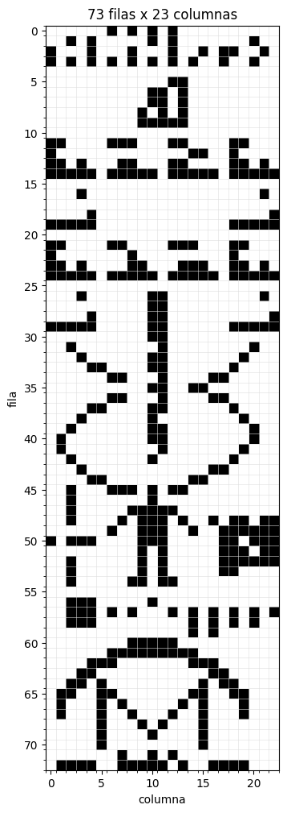
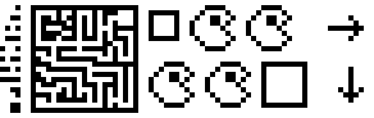
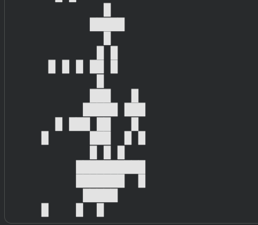

# Laboratorio L1 — Primer contacto

**Curso:** Introducción a las Ciencias de la Computación  
**Institución:** Universidad Nacional de Colombia — Sede Manizales  
**Equipo / especie:** Glitx Synkai  
**Herramientas:** Python, Google Colab, GitHub, Markdown y Obsidian

Este repositorio reúne el trabajo desarrollado en el **Laboratorio L1 — Primer contacto**: interpretación del mensaje de Arecibo, construcción y verificación de herramientas de representación, diseño de un mensaje propio, simulación de un canal con ruido y análisis de un mensaje recibido de otra especie.

El propósito central es reflexionar sobre **cómo representar, transmitir y recuperar información cuando el receptor desconoce nuestras convenciones de lectura**.

## Navegación del laboratorio

| Etapa | Cuaderno de Google Colab | Documentación |
|---|---|---|
| **Sesión 1 · Recibir** | [L1_sesion1.ipynb](sesion_1/L1_sesion1.ipynb) | [Momento 1](sesion_1/momento_1.md) · [Momento 2](sesion_1/momento_2.md) · [Momento 3](sesion_1/momento_3.md) |
| **Tarea puente** | [L1_tarea_puente.ipynb](tarea_puente/L1_tarea_puente.ipynb) | [Parte A: reproducción](tarea_puente/parte_a.md) · [Parte B: bases numéricas](tarea_puente/parte_b.md) · [Parte C: diseño del mensaje](tarea_puente/parte_c.md) |
| **Sesión 2 · Responder** | [L1_sesion2.ipynb](sesion_2/L1_sesion2.ipynb) | [Construcción y transmisión](sesion_2/momento_2.md) · [Recepción y descifrado](sesion_2/recibiendo_un_mensaje.md) |
| **Uso de IA** | — | [Bitácora de IA](bitacora_IA_L1.md) |

## Organización de archivos

```text
laboratorio_primer_contacto/
├── README.md
├── .gitignore
├── bitacora_IA_L1.md
├── mensaje.txt                         # Mensaje propio, protegido y transmitido
├── recibido.txt                        # Mensaje de la otra especie
├── sesion_1/
│   ├── L1_sesion1.ipynb
│   ├── momento_1.md
│   ├── momento_2.md
│   ├── momento_3.md
│   └── imagenes/
│       ├── arecibo_23_columnas.png
│       └── matriz_recortada*.png
├── tarea_puente/
│   ├── L1_tarea_puente.ipynb
│   ├── parte_a.md
│   ├── parte_b.md
│   ├── parte_c.md
│   ├── glitx_synkai_mensaje_bits.txt   # Boceto original: 1679 bits
│   └── imagenes/
│       ├── boceto_original.png
│       └── reconstruccion_del_boceto.png
└── sesion_2/
    ├── L1_sesion2.ipynb
    ├── momento_2.md                    # Construcción y canal con ruido
    ├── recibiendo_un_mensaje.md        # Análisis del mensaje ajeno
    └── imagenes/
        ├── conteo_recibido_colab.png
        ├── laberinto_colab.png
        ├── personaje_colab.png
        └── seccion_2_recibido_colab.png
```

## Desarrollo y resultados

### 1. Sesión 1 — Interpretación de Arecibo

Se analizaron **1679 bits**, con factorización $1679 = 23 \times 73$, y se construyeron herramientas de Python para determinar primalidad, obtener rectángulos, organizar cadenas en filas, dibujar matrices y leer números binarios. Después se estudiaron las secciones del mensaje y las convenciones necesarias para interpretarlas.



[Consultar el análisis y las pruebas](sesion_1/momento_2.md).

### 2. Tarea puente — Reproducir, convertir y diseñar

- **Parte A:** reproducción y comprobación de la integridad del mensaje mediante la huella **SHA-256** y las cifras de referencia del curso.
- **Parte B:** implementaciones iterativa y recursiva del cambio de base y su función inversa, con pruebas de casos concretos y **1000 casos aleatorios**.
- **Parte C:** creación de la especie ficticia **Glitx Synkai**, cuyo sistema numérico es de **base 8**. Se diseñó un boceto de **1679 bits** con conteo, laberinto y desplazamiento de un personaje.



[Consultar el diseño y contrato de lectura](tarea_puente/parte_c.md) · [Ver los bits del boceto](tarea_puente/glitx_synkai_mensaje_bits.txt).

### 3. Sesión 2 — Construcción y transmisión

La versión definitiva del mensaje **antes de la protección** contiene **2491 bits**, distribuidos en **53 filas de 47 columnas**, con filas de ceros como separadores entre secciones.

Se implementó un canal que invierte cada bit con probabilidad $p = 0.01$ y se compararon dos mecanismos de protección: paridad par y repetición triple con votación mayoritaria.

| Indicador | Resultado observado |
|---|---:|
| Mensaje original ensamblado | 2491 bits |
| Mensaje protegido por paridad | 2544 bits |
| Mensaje protegido por repetición triple | 7473 bits |
| Simulaciones realizadas | 1000 |
| Transmisiones con errores detectados por paridad | 1000 de 1000 |
| Mensajes recuperados exactamente por repetición triple | 459 de 1000 |

Se eligió la **repetición triple** para la transmisión final. El archivo [**`mensaje.txt`**](mensaje.txt) contiene los **7473 bits enviados**, después de aplicar una sola vez el ruido simulado. Las cifras corresponden a la ejecución documentada, no a una garantía de recuperación.

[Ver implementaciones, experimentos y justificación](sesion_2/momento_2.md) · [Abrir cuaderno de la sesión 2](sesion_2/L1_sesion2.ipynb).

### 4. Recepción — Análisis de un mensaje desconocido

El archivo [**`recibido.txt`**](recibido.txt) contiene **1311 bits**. Mediante las herramientas construidas durante el laboratorio se plantearon las siguientes hipótesis:

| Aspecto | Evidencia o interpretación provisional |
|---|---|
| Protección | Posible repetición triple: **422 de 437** grupos de tres bits son uniformes |
| Cadena después de votación | **437 bits** |
| Disposición elegida | **23 filas × 19 columnas** |
| Sistema numérico probable | **Base 6**, con conteo del **1 al 8** |
| Figuras observadas | Posibles figuras de **una cruz y una taza** |



Estas interpretaciones son **hipótesis**. Todavía no se conoce el contrato de lectura de la especie emisora y, por tanto, no se puede afirmar que las figuras hayan sido comprendidas correctamente.

[Leer el registro de observaciones, pruebas e hipótesis](sesion_2/recibiendo_un_mensaje.md).

## Estado del trabajo

Los **tres cuadernos `.ipynb`**, la documentación de las etapas, las imágenes principales, el mensaje transmitido, el mensaje recibido y la bitácora de IA están incluidos en este repositorio.

Quedan pendientes de contrastar las hipótesis del mensaje recibido con el **contrato de lectura** de la otra especie y desarrollar las conclusiones posteriores a la revelación correspondientes a la sesión 2. La bitácora de IA conserva un resumen de las intervenciones relevantes; la contraprueba final depende de esa revelación.

## Cómo consultar el repositorio

1. Recorrer la tabla de **Navegación del laboratorio** siguiendo las tres etapas.
2. Abrir los cuadernos `.ipynb` en GitHub, Jupyter o Google Colab para revisar las implementaciones y los resultados guardados.
3. Consultar los archivos Markdown y sus imágenes para seguir las decisiones, pruebas, observaciones y reflexiones.
4. Distinguir los **resultados comprobados** de las **hipótesis de interpretación**.

## Uso de inteligencia artificial

Se utilizó IA como acompañamiento para aclarar conceptos, revisar errores y organizar la documentación, manteniendo las decisiones, implementaciones y verificaciones como trabajo propio. El registro resumido se encuentra en [**bitacora_IA_L1.md**](bitacora_IA_L1.md).

## Referencia académica

[Guía, cuadernos y materiales oficiales del Laboratorio L1 — Primer contacto](https://github.com/cmorregof/labs-calculo-2026-2/tree/main/introduccion_cc).

---

*Laboratorio L1 — Primer contacto · Universidad Nacional de Colombia, Sede Manizales.*
