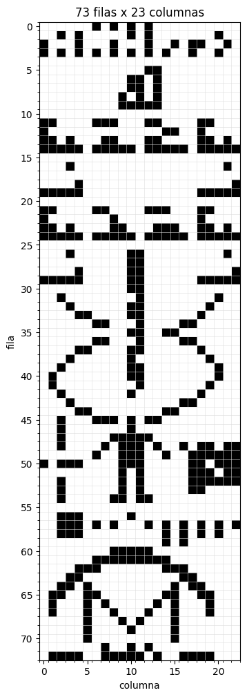
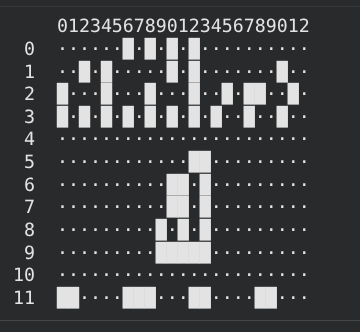
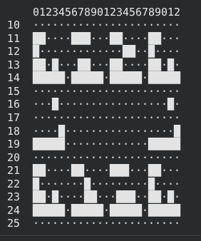
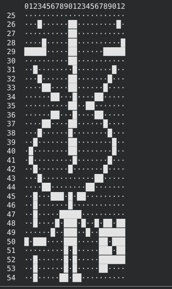
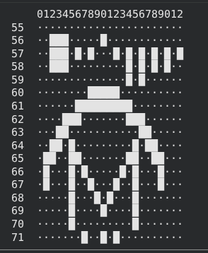

# Sesión 1 — Momento 2: Ejecutar

**Laboratorio L1 — Primer contacto · Cuaderno:** `**L1_sesion1.ipynb**`

## Actividad 1. Traer y conocer el dato

La función proporcionada `cargar_mensaje()` permite obtener la secuencia. Para examinarla utilicé:

```python
n_caracteres = len(bits)
distintos = set(bits)
n_unos = bits.count("1")
n_ceros = bits.count("0")

print("caracteres:", n_caracteres)
print("distintos:", distintos)
print("unos/ceros:", n_unos, n_ceros)
print(bits[:60])
```

**Resultados de ejecución**

|Propiedad|Resultado|
|---|---|
|Número de caracteres|1679|
|Caracteres distintos|`{'1', '0'}`|
|Unos|397|
|Ceros|1282|
|Primeros 60 caracteres|`000000101010100000000000010100000101000000010010001000100010`|

> [!TIP]  
> **Hipótesis propia:** si los bits representan un dibujo, los ceros podrían corresponder al fondo y los unos a sus detalles. Falta contrastarlo con una distribución visual.

**Representación y almacenamiento**

```python
bits_en_disco = len(bits.encode("ascii")) * 8
print("El mensaje tiene", len(bits), "bits de información y ocupa", bits_en_disco, "bits en el disco.")
```

```
El mensaje tiene 1679 bits de información y ocupa 13432 bits en el disco.
```

**¿Qué diferencia existe entre el carácter** `**'1'**` **y el bit** `**1**`**?** El bit representa un valor binario; el carácter `'1'` es un símbolo de texto que, en la codificación ASCII utilizada, ocupa 8 bits al almacenarse. Por ello, el valor binario y su representación textual no son el mismo dato.

## Actividad 2. La llave: `es_primo(n)`

**Implementación propia**

```python
def es_primo(n):
	esPrimo=(n>=2)
	d=2

	while d*d <=n and esPrimo:
		if n%d==0:
			esPrimo=False
		d+=1
	return esPrimo
```

**Pruebas registradas**

|Entrada|Resultado|
|---|---|
|91|`False`|
|97|`True`|
|1679|`False`|

```
✔ es_primo pasa las pruebas.
¿1679 es primo? False
```

## Actividad 3. Las formas posibles: `rectangulos(n)`

La función obtiene las parejas ordenadas `(filas, columnas)` cuyo producto es `n`.

**Implementación propia**

```python
def rectangulos(n):

    parejas = []

    for i in range(1,n+1):
        for j in range(1,n+1):
            if i*j == n:
                parejas.append((i,j))

    return parejas
```

**Pruebas registradas**

|Entrada|Número de parejas|
|---|---|
|12|6|
|7|2|
|1679|4|
|1680|40|

```
✔ rectangulos pasa las pruebas.
Formas de acomodar 1679: [(1, 1679), (23, 73), (73, 23), (1679, 1)]
Formas de acomodar 1680: 40
```

>**¿Por qué pudo elegirse una longitud que es producto de dos primos?** 

La factorización `1679 = 23 × 73` deja pocas distribuciones rectangulares posibles y podría facilitar la búsqueda de la forma original. No es posible asegurar solo con este resultado que esa fuera la intención del diseñador.

>**¿Qué cambia si hay 1680 bits?** 

En las pruebas, 1680 admite 40 parejas de dimensiones, frente a las cuatro de 1679. Por ello, hay más configuraciones que examinar.

### Optimización opcional realizada

Para reducir las divisiones probadas, desarrollé otra versión que busca divisores mientras `d*d <= n` y obtiene la pareja mediante división entera, evita duplicados y ademas ordena la lista. Esta es la implementación registrada en mis apuntes:

```python
def rectangulos_rapido(n):

	parejas=[]

	d=1
	vueltas=0

	while d*d<=n:
		if n % d==0:
			parejas.append((d,n//d))

			#La condicion evita repetir pareja cuando es un cuadrado perfecto
			if(d != n//d):
				parejas.append((n//d,d))

		vueltas+=1
		d+=1
		
	#Ordemanos las parejas
	parejas.sort()
	
	print(f"el Algoritmo hizo: {vueltas} vueltas")
	return parejas
```

```python
#Comprobando que las dos versiones devuelven las misma parejas

assert rectangulos(12)==rectangulos_rapido(12)

assert rectangulos(100)==rectangulos_rapido(100)
```

**Comparación registrada**

|Entrada|Versión original|Versión optimizada|
|---|---|---|
|1679|2 819 041 iteraciones|40 iteraciones|
|1 000 000|Más de 2 minutos sin finalizar|1000 iteraciones|

> [!NOTE]  
> La fila de 1 000 000 compara una ejecución no finalizada con un conteo de iteraciones; no son mediciones equivalentes.


---
## Actividad 4. Ver: `filas_de` y `dibujar`

### Implementación propia

La función `filas_de(bits, columnas)` organiza una cadena binaria en renglones del tamaño indicado.

```python
def filas_de(bits, columnas):
    """CONTRATO
    Recibe: una cadena de bits y un número de columnas que divide su longitud.
    Devuelve: la lista de renglones, cada uno de longitud 'columnas'.
    """
    if len(bits) % columnas == 0:
        b = columnas
        i = 0
        renglones = []

        while b <= len(bits):
            renglones.append(bits[i:b])
            i = b
            b = i + columnas

        return renglones
    else:
        print("El # de columnas debe dividir la longitud de la cadena de bits")
```

La función `dibujar(bits, columnas)` utiliza `filas_de` para imprimir los renglones, representando los unos mediante `█` y los ceros mediante espacios.

```python
def dibujar(bits, columnas):
    """CONTRATO
    Recibe: una cadena de bits y un número de columnas.
    Devuelve: nada. Imprime los renglones con '█' para 1 y ' ' para 0.
    """
    renglones = filas_de(bits, columnas)
    for i in renglones:
        aux = ''
        for j in i:
            if j == '1':
                aux += '█'
            elif j == '0':
                aux += ' '
        print(aux)
```

### Pruebas y verificación

Se ejecutaron las pruebas del cuaderno utilizando la cadena original `bits` de 1679 caracteres.

```python
assert filas_de("101100", 3) == ["101", "100"]
assert filas_de("101100", 2) == ["10", "11", "00"]
assert len(filas_de(bits, 23)) == 73
print("✔ filas_de pasa las pruebas.")
```

**Resultado:**

```
✔ filas_de pasa las pruebas.
```

### Visualización del mensaje

Se probaron las dos distribuciones indicadas en la guía:

```python
dibujar(bits, 73)
dibujar(bits, 23)
```

|Distribución|Observación|
|---|---|
|23 filas × 73 columnas|Los bloques aparecen dispersos y no logré identificar figuras reconocibles.|
|73 filas × 23 columnas|Se distinguen patrones organizados y algunas figuras conocidas.|

**Visualización mediante la función proporcionada** `**dibujar_imagen**`**:**

```python
dibujar_imagen(bits, 23)
```

**Imagen obtenida**




> [!NOTE]  
> **Observación:** La distribución de 23 columnas presenta una estructura visual más reconocible. Identifiqué una figura que podría representar a una persona y otra semejante a la letra M. Sin embargo, todavía no es posible asegurar que estas figuras tengan el significado que les estoy atribuyendo.

La comparación muestra que una misma secuencia binaria puede producir representaciones visuales diferentes dependiendo de cómo se organice en filas y columnas.

---
# Actividad 5 — Descifrado del mensaje de Arecibo

## 5.1. Objetivo

El objetivo de esta actividad es comenzar a interpretar el contenido del mensaje de Arecibo, utilizando la representación matricial obtenida anteriormente y las funciones desarrolladas en Python.

Para realizar el análisis, se utiliza la distribución de **23 columnas y 73 filas**, ya que esta permite reconocer diferentes figuras y patrones dentro del mensaje.

En esta primera parte se estudia la sección superior de la matriz, con el propósito de identificar qué información contiene y cómo está organizada.

---

## 5.2. Observación inicial de la matriz

Para estudiar con mayor detalle la parte superior del mensaje, se utilizó la función `recorte()`, proporcionada en el cuaderno del laboratorio.

```python
recorte(bits, 23, 0, 12, 0, 23)
```

Esta instrucción permite visualizar las primeras 12 filas y las 23 columnas de la representación matricial.

**Resultado**




Al observar el resultado, se identificaron algunas características:

- En las primeras filas aparecen bits `1` distribuidos en diferentes columnas.
    
- En la fila 3 se observa un patrón de unos separados de manera relativamente regular.
    
- Algunas columnas contienen varios bits `1` distribuidos verticalmente.
    
- La distribución sugiere que determinados grupos de bits podrían contener información numérica.
    

A partir de estas observaciones, se decidió examinar las columnas individualmente.

> [!NOTE] Hipótesis inicial  
> Los bits de las primeras filas podrían representar números escritos verticalmente en binario. Algunos de los bits podrían funcionar como marcadores para identificar la ubicación de cada número.

---

## 5.3. Análisis de las primeras columnas

Se comenzó estudiando las columnas 0 y 2, considerando las filas 0 a 3.

### Columna 0

La secuencia obtenida, leída de arriba hacia abajo, fue:

```
0011
```

### Columna 2

La secuencia obtenida fue:

```
0101
```

Al comparar ambas columnas, se obtuvo:

|Fila|Columna 0|Columna 2|
|---|---|---|
|0|0|0|
|1|0|1|
|2|1|0|
|3|1|1|

Se observó que ambas secuencias terminan en `1`, aunque los tres bits anteriores son diferentes.

Esto llevó a considerar la posibilidad de que el último `1`, correspondiente a la fila 3, fuera un marcador y no formara parte del número representado.

### Interpretación sin el posible marcador

Al excluir el bit de la fila 3, las secuencias quedan:

|Columna|Secuencia completa|Bits considerados|Valor decimal|
|---|---|---|---|
|0|`0011`|`001`|1|
|2|`0101`|`010`|2|

Por tanto:

$$
001_2=1_{10}  
$$

$$
010_2=2_{10}  
$$

Los valores obtenidos son consecutivos, lo que proporciona una primera evidencia a favor de la hipótesis.

> [!IMPORTANT] Primera deducción  
> Es posible que los bits de las filas 0, 1 y 2 representen números binarios y que los unos de la fila 3 permitan identificar su ubicación.

Esta interpretación debía comprobarse con otras columnas antes de considerarla válida.

---

## 5.4. Comprobación mediante Python

Para verificar la hipótesis se utilizaron dos funciones desarrolladas previamente:

- `columna()`: permite extraer los bits de una columna de la matriz dentro de un intervalo de filas.
    
- `leer_numero()`: permite interpretar una lista de bits como un número binario y obtener su valor decimal.
    

La función `columna()` recibe los siguientes argumentos:

```
columna(bits, columnas, j, fila_desde, fila_hasta)
```

Para examinar una columna y excluir la fila 3, se seleccionaron los siguientes parámetros:

|Parámetro|Valor|Justificación|
|---|---|---|
|`bits`|`bits`|Cadena original del mensaje|
|`columnas`|`23`|Número de columnas de la matriz|
|`j`|Columna seleccionada|Posición que se desea estudiar|
|`fila_desde`|`0`|Primera fila de lectura|
|`fila_hasta`|`3`|Límite superior exclusivo; se leen las filas 0, 1 y 2|

### Comprobación de la columna 4

Se realizó la siguiente ejecución:

```python
binario = columna(bits, 23, 4, 0, 3)
numero = leer_numero(binario)
print(numero)
```

**Resultado obtenido:**

```
3
```

Este resultado fue coherente con los dos números anteriores.

Posteriormente, se decidió comprobar si el patrón continuaba en las siguientes columnas pares.

---

## 5.5. Identificación de los números del 1 al 7

Durante el análisis se observó que, al seleccionar las columnas pares desde la columna 0, los valores decimales obtenidos aumentaban consecutivamente.

Los resultados fueron:

|Columna|Número decimal obtenido|
|---|---|
|0|1|
|2|2|
|4|3|
|6|4|
|8|5|
|10|6|
|12|7|

De esta manera, se logró identificar la secuencia:

$$  
1,\ 2,\ 3,\ 4,\ 5,\ 6,\ 7  
$$

### Interpretación

Los resultados sugieren que:

1. Cada uno de estos números está representado verticalmente en una columna.
    
2. Los bits que representan el número se encuentran en las primeras tres filas.
    
3. La fila 3 podría contener marcadores que ayudan a distinguir los números.
    
4. Las columnas pares estudiadas siguen un patrón de separación regular.
    

Esta interpretación es consistente con los resultados obtenidos mediante las funciones de Python.

> [!NOTE] Limitación de la interpretación  
> Haber identificado un patrón en las columnas pares no significa necesariamente que todos los números del mensaje sigan esa misma organización. Es necesario examinar las columnas posteriores.

---

## 5.6. Dificultad al representar el número 8

Después de identificar el número 7, surgió una dificultad relacionada con la cantidad de bits necesarios para representar números mayores.

En particular, el número 8 tiene la siguiente representación binaria:

$$  
8_{10}=1000_2  
$$

A diferencia de los números del 1 al 7, el número 8 necesita **cuatro bits significativos**.

Sin embargo, en las columnas estudiadas anteriormente se estaban utilizando únicamente tres posiciones para representar cada número.

Por esta razón, se consideró que el número 8 podría estar distribuido en más de una columna.

### Observación de las columnas 14 y 15

Al examinar las columnas siguientes, se identificó que era posible construir el número 8 combinando los bits de las columnas 15 y 14.

Los bits considerados fueron:

|Orden de lectura|Columna|Bits|
|---|---|---|
|Primera|15|`001`|
|Segunda|14|`000`|

Al concatenarlos en ese orden, se obtiene:

```
001000
```

Su valor decimal es:

$$ 
001000_2=8_{10}  
$$

Los ceros iniciales no modifican el valor del número, por lo que:

$$  
001000_2=1000_2=8_{10}  
$$

### Deducción

La representación del número 8 sugiere que algunos números utilizan más de una columna y que, en estos casos, los grupos de bits se concatenan comenzando por la columna situada a la derecha.

También se observó que:

- El posible bit de control se encuentra en la columna 14.
    
- El primer `1` significativo del número aparece en la columna 15.
    

Por tanto, el marcador no necesariamente coincide con la columna que contiene el bit más significativo del número.

> [!IMPORTANT] Nueva hipótesis  
> Cuando un número necesita más de tres bits, su representación puede extenderse a dos columnas. En el caso estudiado, los bits se interpretan leyendo primero la columna situada a la derecha y después la de la izquierda.

---

## 5.7. Interpretación de los números 9 y 10

Después de identificar el número 8, se decidió comprobar si el mismo procedimiento permitía interpretar los números siguientes.

### Número 9

Se examinaron las columnas 16 y 17.

Aplicando el mismo criterio de lectura, se obtuvo:

```
001001
```

La conversión decimal es:

$$ 
001001_2=2^3+2^0  
$$

$$ 
001001_2=8+1=9_{10}  
$$

Este resultado permitió continuar la secuencia numérica identificada anteriormente.

### Número 10

Posteriormente, se examinaron las columnas 18 y 19.

La secuencia obtenida fue:

```
001010
```

Su conversión decimal es:

$$
001010_2=2^3+2^1  
$$

$$  
001010_2=8+2=10_{10}  
$$

Por tanto, también fue posible recuperar el número 10 mediante el mismo procedimiento.

### Comparación de resultados

|Número decimal|Columnas examinadas|Representación binaria obtenida|
|---|---|---|
|8|14 y 15|`001000`|
|9|16 y 17|`001001`|
|10|18 y 19|`001010`|

Estos resultados muestran que la interpretación utilizada para el número 8 también funciona para los números 9 y 10.

---

## 5.8. Resultado del descifrado de la primera sección

Combinando los resultados obtenidos, se logró reconstruir la siguiente secuencia:

$$  
\boxed{1,\ 2,\ 3,\ 4,\ 5,\ 6,\ 7,\ 8,\ 9,\ 10}  
$$

La interpretación se realizó mediante dos procedimientos:

|Números|Representación observada|Procedimiento empleado|
|---|---|---|
|Del 1 al 7|Una columna por número|Lectura de los bits de las filas 0 a 2|
|Del 8 al 10|Dos columnas por número|Concatenación de los grupos de bits, comenzando por la columna de la derecha|

Se identificaron dos características importantes de esta primera sección:

**Primera:** la información está organizada en números binarios que pueden convertirse a valores decimales.

**Segunda:** existen bits que parecen cumplir una función de señalización, lo que permite distinguir los números y reconocer su posición.

Aunque la interpretación es consistente con la secuencia encontrada, la función exacta de los marcadores continúa siendo una hipótesis basada en la observación.

---

## 5.9. Reflexión sobre el significado de la primera sección

Una vez identificada la secuencia del 1 al 10, se planteó la siguiente pregunta:

**¿Por qué los autores del mensaje habrían decidido incluir esta secuencia al comienzo?**

Considero que podría tratarse de una forma de indicar **cómo contamos y cómo representamos las cantidades**.

La secuencia presenta una regularidad matemática que podría ser reconocida sin necesidad de comprender un idioma humano.

Además, al representar los números en binario, el mensaje comunica una convención numérica que podría servir como referencia para interpretar otras partes de su contenido.

Sin embargo, esto no garantiza que otra civilización interprete inmediatamente la secuencia de la misma manera. Sería necesario que identificara la organización de los bits, la orientación de lectura y la relación entre las representaciones binarias y sus valores.

---

## 5.10. Conclusión de la primera sección

A partir de la observación de la matriz de 23 columnas y del uso de las funciones desarrolladas en Python, fue posible interpretar la primera sección del mensaje de Arecibo.

Inicialmente, se identificó un patrón en las columnas pares, donde los bits de las primeras tres filas permitieron recuperar los números del 1 al 7.

Posteriormente, se reconoció que los números del 8 al 10 necesitaban más bits y podían reconstruirse mediante la combinación de dos columnas.

De esta manera, se obtuvo la secuencia completa de los números del 1 al 10.

El análisis también permitió formular una hipótesis sobre la función de ciertos bits como marcadores para distinguir la ubicación de los números.

Finalmente, considero que esta sección podría tener como propósito comunicar nuestro sistema de conteo mediante una secuencia matemática reconocible, proporcionando una primera referencia para interpretar el resto del mensaje.

> [!NOTE] Estado de la actividad  
> **Primera sección analizada:** números del 1 al 10.
> 
> **Herramientas utilizadas:** representación matricial, `recorte()`, `columna()` y `leer_numero()`.
> 
> **Siguiente sección:** pendiente de análisis.

## 5.11. Descifrado de la segunda sección del mensaje de Arecibo

### 5.11.1. Objetivo

Después de identificar los números del 1 al 10 en la primera sección, se continuó con el análisis de la siguiente región del mensaje.

Según las instrucciones del cuaderno, esta sección contiene cinco números adicionales que deben interpretarse utilizando el mismo procedimiento desarrollado anteriormente.

Una vez identificados, se deben relacionar con los elementos de la tabla periódica proporcionada en el laboratorio.

---

### 5.11.2. Observación de la matriz


Al examinar nuevamente la representación del mensaje de Arecibo, se observaron patrones similares en distintas regiones de la matriz.

Inicialmente, se identificó una semejanza entre la distribución de los bits de las filas 10 a 14 y la de las filas 20 a 24.

Posteriormente, se decidió concentrar el análisis en las filas 5 a 9, que corresponden a la región situada inmediatamente después de los números de la primera sección.

En esta región se observaron las siguientes características:

- Los bits `1` se encuentran concentrados principalmente en las columnas centrales.
    
- La distribución visual presenta una agrupación predominantemente horizontal.
    
- En la fila 9 aparece una secuencia de unos consecutivos.
    
- Los bits situados encima de esta fila presentan agrupaciones verticales.
    

A partir de estas observaciones, se planteó la posibilidad de que la fila 9 cumpliera una función semejante a la de la fila 3 en la primera sección.

> [!NOTE] Hipótesis inicial  
> Los bits `1` de la fila 9 podrían funcionar como marcadores para identificar números binarios representados verticalmente en las filas superiores.

---

### 5.11.3. Identificación de los números binarios

Para comprobar la hipótesis, se decidió estudiar las columnas 9 a 13, considerando únicamente los bits comprendidos entre las filas 5 y 8.

Se aplicó el mismo criterio de lectura utilizado anteriormente: interpretar los bits de cada columna de arriba hacia abajo y excluir la fila que posiblemente contiene los marcadores.

#### Análisis de la columna 9

Al observar la columna 9, se obtuvo la secuencia:

```
0001
```

Su interpretación decimal es:

$$  
0001_2=1_{10}  
$$

#### Análisis de la columna 10

La secuencia identificada fue:

```
0110
```

Al convertirla a decimal:

$$  
0110_2=4+2=6_{10}  
$$

#### Análisis de la columna 11

Se obtuvo:

```
0111
```

Por tanto:

$$  
0111_2=4+2+1=7_{10}  
$$

#### Análisis de la columna 12

La secuencia encontrada fue:

```
1000
```

De donde:

$$  
1000_2=8_{10}  
$$

#### Análisis de la columna 13

Finalmente, se identificó:

```
1111
```

Inicialmente, se interpretó incorrectamente este número como 11. Sin embargo, al revisar los valores posicionales de los bits, se corrigió la conversión:

$$  
1111_2=8+4+2+1=15_{10}  
$$

---

### 5.11.4. Resultados obtenidos

Los cinco números identificados fueron:

|Columna|Bits de las filas 5 a 8|Valor decimal|
|---|---|---|
|9|`0001`|1|
|10|`0110`|6|
|11|`0111`|7|
|12|`1000`|8|
|13|`1111`|15|

Por tanto, se obtuvo la secuencia:

$$  
\boxed{1,\ 6,\ 7,\ 8,\ 15}  
$$

A diferencia de los números identificados en la primera sección, estos valores no forman una secuencia consecutiva.

Sin embargo, la interpretación es consistente con la hipótesis de que los bits situados encima de la fila 9 representan números binarios.

> [!IMPORTANT] Deducción  
> La segunda sección contiene cinco números binarios representados verticalmente en columnas consecutivas. Los unos de la fila 9 podrían cumplir una función de señalización semejante a la identificada en la primera sección.

---

### 5.11.5. Relación con la tabla periódica

El cuaderno indica que los cinco números obtenidos deben buscarse en la tabla periódica, donde cada elemento químico está identificado por un número atómico.

Al consultar la tabla proporcionada en el laboratorio, se obtuvo:

|Número atómico|Símbolo químico|Elemento|
|---|---|---|
|1|H|Hidrógeno|
|6|C|Carbono|
|7|N|Nitrógeno|
|8|O|Oxígeno|
|15|P|Fósforo|

Por tanto, los números descifrados representan los elementos:

$$
\boxed{\mathrm{H,\ C,\ N,\ O,\ P}}  
$$

Estos resultados permitieron establecer que la segunda sección comunica información relacionada con elementos químicos.

---

### 5.11.6. Relación de los elementos con la vida

Después de identificar los cinco elementos, se planteó la siguiente pregunta:

**¿Qué molécula fundamental para los seres vivos contiene hidrógeno, carbono, nitrógeno, oxígeno y fósforo?**

Debido a que mis conocimientos de química son limitados, decidí investigar qué moléculas contienen estos elementos.

Como resultado de la consulta, encontré que el **ADN (ácido desoxirribonucleico)** está compuesto por estructuras químicas que contienen los cinco elementos identificados.

El ADN es una molécula fundamental para los seres vivos, ya que almacena información genética relacionada con sus características y funcionamiento.

Es importante señalar que estos elementos no son exclusivos del ADN, pues también se encuentran en otras moléculas esenciales para la vida.

> [!NOTE] Interpretación  
> La presencia de estos elementos podría estar relacionada con la intención de comunicar información sobre la composición química de los seres vivos de la Tierra, especialmente de moléculas fundamentales como el ADN.

---

### 5.11.8. Conclusión de la segunda sección

Mediante la observación de la matriz del mensaje de Arecibo, se identificó una agrupación de bits en las filas 5 a 9 que presentaba características semejantes a las encontradas en la primera sección.

Se planteó que la fila 9 podría contener marcadores y que los bits de las cuatro filas superiores representaban números binarios.

Al estudiar las columnas 9 a 13, se obtuvo la secuencia de números:

$$ 
1,\ 6,\ 7,\ 8,\ 15  
$$

Posteriormente, se relacionaron estos valores con sus respectivos números atómicos, identificando los elementos hidrógeno, carbono, nitrógeno, oxígeno y fósforo.

A partir de una investigación sobre estos elementos, se encontró su relación con el ADN y otras moléculas fundamentales para la vida.

Finalmente, considero que las dos primeras secciones del mensaje buscan comunicar información sobre nuestra manera de contar y sobre la composición química de los seres vivos de la Tierra.

---
# 6. Inventario del mensaje de Arecibo

## 6.1. Objetivo

El propósito de esta actividad es identificar qué información podría comunicar cada región del mensaje de Arecibo, diferenciando entre los resultados comprobados mediante código y las interpretaciones obtenidas mediante la observación visual.

No se busca descifrar completamente el mensaje, sino reconocer qué información hemos logrado verificar y qué permanece como hipótesis.

## 6.2. Inventario de las regiones

|Filas|¿Qué creemos que dice?|¿Código o interpretación visual?|¿Cómo lo comprobaríamos?|
|---|---|---|---|
|**0–3**|Números naturales del 1 al 10.|Identificación visual y comprobación mediante código.|Se utilizaron `columna()` y `leer_numero()`, combinando dos columnas cuando fue necesario.|
|**5–9**|Números atómicos de H, C, N, O y P, elementos presentes en el ADN.|Comprobación numérica mediante código e interpretación mediante la tabla periódica.|Se obtuvieron los valores 1, 6, 7, 8 y 15 y se contrastaron con sus respectivos elementos químicos.|
|**10–24**|Podría representar una estructura completa formada por distintas figuras relacionadas.|Principalmente observación visual, con algunas repeticiones comprobadas mediante código.|Se verificó la igualdad de determinadas secuencias, aunque su significado continúa siendo desconocido.|
|**25–44**|Estructura alargada con cierta regularidad y apariencia aproximadamente simétrica.|Interpretación visual.|No se ha establecido una interpretación verificable.|
|**45–54**|Figura de una persona.|Interpretación visual.|Se reconocieron características semejantes a una cabeza, tronco y extremidades.|
|**55–59**|Posible figura completa cuya disposición recuerda a una bandera horizontal.|Interpretación visual.|Todavía no se ha definido un procedimiento de comprobación.|
|**60–72**|Posible construcción semejante a una casa o templo.|Interpretación visual.|Se identificaron formas que recuerdan a un techo, pilares y cimientos, pero no se ha comprobado su significado.|

## 6.3. Observaciones sobre las regiones no descifradas

### Filas 10–24




Al examinar esta región, observé diferentes patrones que se repiten.

Entre las filas 10 y 14 identifiqué figuras iguales en los extremos izquierdo y derecho. Posteriormente comprobé mediante `columna()` que algunas secuencias binarias coincidían:

|Columnas izquierdas|Columnas derechas|Secuencias|
|---|---|---|
|0, 1 y 3|18, 19 y 21|`111`, `101`, `001`|

También observé que:

- Entre las filas 15 y 19 aparece una figura diferente, repetida en ambos extremos.
    
- Entre las filas 20 y 24 reaparecen las figuras exteriores observadas en las filas 10 a 14.
    
- Las figuras interiores presentan diferencias entre sí.
    
- En las regiones centrales se repite frecuentemente la secuencia `101`.
    

Inicialmente consideré que estas secuencias podrían representar números atómicos, pero después descarté esa interpretación como explicación suficientemente fundamentada.

Mi hipótesis actual es que las diferentes figuras podrían formar parte de una estructura completa, aunque desconozco su significado.

### Filas 25–54




Entre las filas 25 y 44 identifiqué una figura alargada que presenta cierta regularidad. Algunas de sus partes parecen simétricas, aunque la simetría no es exacta.

Posteriormente, entre las filas 45 y 54 reconocí una figura semejante a una persona, pues pude distinguir su cabeza, tronco y extremidades.

Esta última interpretación se basa en mi conocimiento de la anatomía humana y no en un descifrado numérico.

### Filas 55–72




En las filas 55 a 59 observé una figura distribuida horizontalmente. Inicialmente pensé que podría representar una herramienta, pero después consideré que se parecía más a una bandera horizontal o a una estructura completa.

En las filas 60 a 72 identifiqué una figura semejante a una construcción. Su parte superior me recuerda a un techo, la región central a unos pilares y la inferior a los cimientos.

Ambas interpretaciones siguen siendo hipótesis visuales.

## 6.4. Conclusión del inventario

El análisis permitió distinguir entre información comprobada mediante las funciones desarrolladas en Python e interpretaciones realizadas a partir de patrones visuales.

Las primeras dos secciones pudieron interpretarse mediante conversiones binarias y la tabla periódica. En cambio, las demás regiones contienen figuras cuyo significado no logré determinar completamente.

Esto demuestra que **reconocer una representación no implica necesariamente comprender la información que intenta comunicar**.

---


_Laboratorio L1 — Primer contacto · Sesión 1 · Momento 2 — Ejecutar_