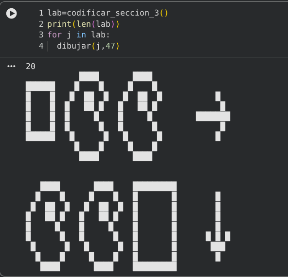

# L1 · Primer contacto — Sesión 2
## Momento 2 · Ejecutar — Construcción del mensaje de los Glitx Synkai

**Especie:** Glitx Synkai  
**Sistema de numeración:** base 8  
**Fuente del diseño original:** `tarea_puente/parte_c.md`

---

## 1. Antecedentes: Momento 1 — Predecir

> [!note] P4 — Predicción de comprensión
> Estimamos que la especie receptora comprenderá aproximadamente **0,5 (50 %)** de nuestro mensaje. La interpretación del laberinto, especialmente la distinción entre paredes (`1`) y espacios transitables (`0`), es la parte que consideramos más vulnerable a una lectura incorrecta.

En la discusión previa se formularon estas estimaciones de comprensión por elemento:

| Elemento | Estimación inicial |
|:--|--:|
| Deducir la disposición rectangular | 0,9 |
| Identificar la base 8 | 0,8 |
| Reconocer las paredes | 0,4 |
| Reconocer los espacios transitables | 0,4 |
| Comprender el recorrido de una región de 2 × 2 hacia otra de 3 × 3 | 0,6 |
| Reconocer el personaje | 0,8 |
| Identificar el orden de lectura | 0,8 |

Estas cifras representan **predicciones subjetivas** sobre la comprensión de componentes, no proporciones medidas de bits descifrados.

> [!note] P5 — Predicción de errores
> Cuando se respondió esta pregunta en papel, el mensaje disponible era el **boceto original de 1679 bits**. Con una probabilidad de error por bit de `p = 0.01`, calculamos una esperanza de `1679 × 0.01 = 16.79` bits alterados por transmisión y `3 × 16.79 = 50.37` bits alterados en el conjunto de tres transmisiones.

La cantidad dañada es un **valor esperado**, no necesariamente el número exacto de errores. También analizamos que tres copias pueden permitir una **votación por mayoría**, aunque no garantizan la recuperación de todos los bits.

> [!warning] Cambio posterior del tamaño del mensaje
> Tras el ensamblado, el mensaje cambió a **2491 bits**. Si repetimos el cálculo de P5 para la versión **final no protegida**, la esperanza pasa a `2491 × 0.01 = 24.91` bits alterados en una transmisión, o `3 × 24.91 = 74.73` alteraciones esperadas entre tres copias. Conviene conservar ambas cifras y explicar su contexto en lugar de modificar retrospectivamente la predicción realizada en papel.

---

## 2. Verificación de las herramientas anteriores

Se reutilizaron las funciones elaboradas en la sesión 1 y en la tarea puente:

- `es_primo`, `rectangulos`;
- `filas_de`, `dibujar`, `leer_numero`, `columna`;
- `a_base_ciclo`, `de_base` (y la versión recursiva desarrollada en la tarea puente).

Se corrigió un error de sintaxis en la prueba de la variable `MI_BASE`: la base de nuestra especie es `8`, y la prueba verifica su pertenencia al conjunto de bases admitidas. Las pruebas de las herramientas anteriores se superaron.

> [!tip] Observación de eficiencia
> La implementación propia de `rectangulos(n)` utiliza dos ciclos anidados de `1` a `n`, por lo cual realiza `n²` comprobaciones. El resultado es válido, aunque su costo crece rápidamente. En el caso de `n = 2491`, se registraron **6 205 081** iteraciones.

## 3. Bits necesarios por dígito

Para una base `b`, necesitamos el menor entero `k` que satisfaga:

$$
2^k\ge b.
$$

Como `MI_BASE = 8`:

$$
2^3 = 8 \quad \Longrightarrow \quad ANCHO = 3.
$$

### Funciones propias

```python
def bits_por_digito(b):
    """CONTRATO. Recibe una base b >= 2. Devuelve el menor k con 2**k >= b."""
    k = 1
    while 2**k < b:
        k += 1
    return k


def digito_a_bits(d, ancho):
    """CONTRATO. Devuelve la representación binaria del dígito
    usando exactamente 'ancho' caracteres, con ceros a la izquierda."""
    lista_bits = a_base_ciclo(d, 2)
    bits = ""
    for i in lista_bits:
        bits += str(i)
    return "0" * (ancho - len(bits)) + bits
```

Las pruebas oficiales pasaron y Colab mostró:

```text
✔ Su especie escribe cada dígito con 3 bits.
```

> [!important] Dos tipos de relleno
> `digito_a_bits` agrega ceros **a la izquierda** para completar un dígito. En cambio, `renglon(contenido)` agrega ceros **a la derecha** para alcanzar el número fijo de columnas establecido en el cuaderno.

---

## 4. Sección 1 — Conteo octal

`codificar_conteo(hasta)` debe devolver un renglón por cada número **del 1 al `hasta`**, convirtiendo primero el número a la base de la especie, representando cada dígito con `ANCHO` bits y completando el renglón con `renglon()`.

### Implementación

```python
def codificar_conteo(hasta):
    """CONTRATO. Devuelve una lista de renglones: el renglón i tiene
    el número i (de 1 a 'hasta') escrito en MI_BASE, cada dígito
    con ANCHO bits."""
    renglones = []
    for i in range(1, hasta + 1):
        base = a_base_ciclo(i, MI_BASE)
        bits = ""
        for j in base:
            bits += digito_a_bits(j, ANCHO)
        rengl = renglon(bits)
        renglones.append(rengl)
    return renglones
```

La prueba del cuaderno:

```python
conteo = codificar_conteo(MI_BASE + 2)
```

produce **10 renglones**. El cambio decisivo es:

$$
(7)_8 = (111)_2,\qquad (10)_8 = (001\ 000)_2.
$$

> [!warning] Ambigüedad interpretativa
> Aunque el conteo es matemáticamente correcto y supera las pruebas del profesor, la transición de `111` a `001000` puede interpretarse como números escritos directamente en binario. El receptor tendría que deducir que cada **tres bits** forman un dígito octal. Durante la tarea puente diseñamos bits de control y separadores, pero **se decidió no añadir nuevas filas ni columnas para recuperarlos en esta versión**. La representación alternativa se estudiará después como ejercicio personal de refuerzo.

---

## 5. Sección 2 — Laberinto

Se decidió **conservar el laberinto original de 21 × 21 celdas**, ubicándolo al extremo izquierdo de cada renglón de la nueva representación.

En el mensaje original, formado por **23 filas y 73 columnas**, el laberinto comienza en la fila `1` y columna `6`, numeradas desde cero. Su índice inicial en la cadena de bits es:

$$
i=73f+c=73(1)+6=79.
$$

Se recuperan 21 fragmentos de 21 bits. El comienzo de cada fila se obtiene avanzando **73 posiciones**, ya que ese es el ancho de la **matriz de origen**:

| Fila | Corte aplicado a la cadena original |
|:--|:--|
| Primera | `bits[79:100]` |
| Segunda | `bits[152:173]` |
| Siguientes | Inicio anterior + 73 |

Cada fragmento pasa por `renglon()` para alcanzar el ancho elegido en la versión ensamblada. **No se debe cambiar el avance de 73**, aunque `COLUMNAS` cambie, porque ese avance corresponde a la matriz original.

La función `codificar_seccion_2()` devuelve **21 renglones**. Se comprobó que la visualización reproduce el laberinto diseñado; la apariencia cambia en Colab porque `dibujar()` representa los unos con el carácter `█`, mientras que en el boceto original eran celdas negras.


---

## 6. Sección 3 — Secuencia del personaje

Se mantuvieron los dibujos del personaje tipo Pac-Man, la región inicial pequeña, la región final mayor y las flechas que indican la secuencia visual.

En la matriz original, se identificó como región de extracción:

| Propiedad | Valor |
|:--|--:|
| Fila inicial | 1 |
| Columna inicial | 29 |
| Índice inicial | 102 |
| Filas extraídas | 20 |
| Bits extraídos por fila | 42 |
| Avance entre filas originales | 73 |

El índice inicial se calculó mediante:

$$
i=73(1)+29=102.
$$

Los primeros cortes son `bits[102:144]` y `bits[175:217]`. Los fragmentos se completan usando `renglon()` y se devuelven como **20 renglones**.

La ejecución de `codificar_seccion_3()` permitió visualizar los personajes y las flechas.



---

## 7. Ensamblado del mensaje

La función `ensamblar(secciones)` fue implementada con dos ciclos anidados: el primero recorre las secciones y el segundo recorre los renglones de cada una, concatenándolos en una sola cadena.

### Implementación propia

```python
def ensamblar(secciones):
    """CONTRATO. Recibe una lista de secciones (cada una, una lista
    de renglones). Devuelve una sola cadena de bits: todos los
    renglones, uno detrás de otro."""
    cadena = ""
    for i in secciones:
        for j in i:
            cadena += j
    return cadena
```

La función **conserva el contrato oficial** de concatenación vertical. Las filas vacías de separación se pasan como elementos adicionales a `ensamblar()`; no se incorporan automáticamente dentro de la función.

## 8. La forma — Decisión final

Inicialmente, con `COLUMNAS = 73`, el mensaje tenía **51 filas** y **3723 bits**:

$$
51\times73=3723=3\times17\times73.
$$

Como 51 no es primo, aparecían numerosas disposiciones rectangulares posibles. Se propuso reducir el ancho a **47 columnas**, porque el dibujo más ancho (la secuencia visual) ocupa **42** y el laberinto **21**. El conteo también cabe en 47 bits.

A continuación, se decidió separar las tres secciones con **una fila completa de ceros entre cada par de secciones**. Así se añaden exactamente dos filas a las 51 existentes:

| Parte | Filas | Rango de filas en el mensaje nuevo |
|:--|--:|:--|
| Conteo octal | 10 | 0–9 |
| Separación de ceros | 1 | 10 |
| Laberinto | 21 | 11–31 |
| Separación de ceros | 1 | 32 |
| Movimiento del personaje | 20 | 33–52 |
| **Total** | **53** | **0–52** |

Por tanto, el mensaje ensamblado tiene:

$$
\boxed{N=53\times47=2491\text{ bits}}.
$$

Como **47 y 53 son números primos**, las únicas parejas de divisores ordenadas son:

```text
(1, 2491), (47, 53), (53, 47), (2491, 1)
```

### Ensamblado con separadores, sin cambiar los contratos

A partir de la implementación propia ya terminada, el estudiante agregó los separadores como listas que contienen un único renglón de ceros:

```python
mensaje = ensamblar([
    codificar_conteo(MI_BASE + 2),
    [COLUMNAS * "0"],
    codificar_seccion_2(),
    [COLUMNAS * "0"],
    codificar_seccion_3()
])
```

El valor final de `COLUMNAS` es **47**. No se modifican las coordenadas de lectura del **boceto original** ni el avance `fila += 73` usado para extraer sus regiones.

### Resultado observado en Google Colab

```text
Longitud del mensaje: 2491 bits
Formas de dibujarlo:
[(1, 2491), (47, 53), (53, 47), (2491, 1)]
```


Se comprobó visualmente la concatenación **conteo → separación → laberinto → separación → personaje**, respetando las tres ideas originales del proyecto.

---
## 9. Las preguntas incómodas de la representación

En esta actividad se analizaron algunas de las limitaciones de mi sistema de representación, considerando las dificultades que podría encontrar otra civilización al intentar interpretar el mensaje de los Glitx Synkai.

Decidí abordar las preguntas relacionadas con el **ancho fijo** y la **representación de números decimales**, ya que ambas están relacionadas con el sistema de numeración en base 8 que utilicé.

### 9.1. Pregunta 1 — Ancho fijo y desbordamiento

> [!question] Enunciado de la guía  
> Si cada número va en un renglón de `COLUMNAS` bits, ¿cuál es el número más grande que cabe en su base? ¿Qué pasa si quieren decir cuántos habitantes tiene Manizales? A esto se le llama **desbordamiento**.

#### 9.1.1. Cantidad de dígitos disponibles

En mi mensaje establecí las siguientes constantes:

```
MI_BASE = 8
ANCHO = 3
COLUMNAS = 47
```

Como trabajo en base 8, cada dígito octal puede representarse mediante **3 bits**.

Para determinar cuántos dígitos completos puedo almacenar en un renglón, dividí la cantidad de columnas entre el ancho de cada dígito:

$$  
\frac{47}{3}=15{,}666\ldots  
$$

Como no puedo utilizar una fracción de dígito, concluí que puedo almacenar **15 dígitos octales completos**.

Estos ocupan:

$$  
15\times 3=45\text{ bits}.  
$$

Por tanto, quedan:

$$  
47-45=2\text{ bits}.  
$$

Los dos bits restantes se utilizan como relleno para completar el ancho del renglón.

#### 9.1.2. Mayor número representable

En base 8, los dígitos disponibles son:

$$  
{0,1,2,3,4,5,6,7}.  
$$

Para construir el número más grande con 15 posiciones, consideré que cada dígito debía tomar su valor máximo, es decir, 7.

Así obtuve:

$$  
\boxed{(777777777777777)_8}.  
$$

Para calcular su valor decimal, utilicé la expresión general del mayor número representable con (k) dígitos en una base (b):

$$  
N_{\max}=b^k-1.  
$$

Esta expresión se obtiene al escribir el valor máximo de cada posición:

$$  
N_{\max}=(b-1)b^{k-1}+\cdots+(b-1)b+(b-1).  
$$

Al factorizar:

$$  
N_{\max}=(b-1)(1+b+\cdots+b^{k-1}).  
$$

Utilizando la suma geométrica:

$$  
1+b+\cdots+b^{k-1}=\frac{b^k-1}{b-1},  
$$

llegué a:

$$  
\boxed{N_{\max}=b^k-1}.  
$$

En mi caso, (b=8) y (k=15), por lo que:

$$  
\boxed{N_{\max}=8^{15}-1}.  
$$

Este es el mayor número entero que puedo representar con mi codificación de dígitos octales dentro de un renglón de 47 bits.

#### 9.1.3. ¿Qué sucede si supero ese límite?

Para analizar el desbordamiento, consideré el número inmediatamente posterior al máximo:

$$  
8^{15}.  
$$

Observé que las potencias de 8 necesitan una posición adicional en su representación octal. Por ejemplo:

$$  
(77)_8+1=(100)_8.  
$$

Siguiendo este patrón, concluí que (8^{15}) necesita **16 dígitos octales**.

Como cada dígito requiere 3 bits:

$$  
16\times3=48\text{ bits}.  
$$

Sin embargo, mis renglones solamente admiten 47 bits:

$$  
48>47.  
$$

Por tanto, no podría almacenar ese número en un único renglón.

También identifiqué que mi función `renglon()` contiene una condición `assert` que comprueba que el contenido no supere el ancho disponible.

Si intentara introducir 48 bits, esta condición no se cumpliría y Python produciría un `AssertionError`.

> [!important] Mi conclusión sobre el desbordamiento  
> Mi sistema permite representar enteros desde cero hasta (8^{15}-1). Una cantidad como el número de habitantes de Manizales podría representarse siempre que no supere ese límite. Sin embargo, si necesitara representar un número mayor, tendría que modificar la convención de representación o ampliar su capacidad.
> 
> La validación mediante `assert` permite detectar el desbordamiento y evita que se acepte silenciosamente un renglón demasiado largo.

---

### 9.2. Pregunta 2 — Números decimales y unidades de medida

> [!question] Enunciado de la guía  
> ¿Cómo dicen la altura de Manizales en metros si el otro no sabe qué es un metro, ni dónde va la coma?
> 
> La guía menciona como referencia las placas de las sondas Pioneer de 1972, que utilizaron una propiedad física del átomo de hidrógeno para comunicar medidas.

#### 9.2.1. Dificultades identificadas

Al analizar esta pregunta, identifiqué dos problemas:

1. **Representar cantidades fraccionarias:** mi sistema actual utiliza números enteros en base 8, por lo que no he definido una convención para representar una parte decimal.
    
2. **Comunicar unidades de medida:** aunque otra civilización consiga interpretar un número, eso no significa que comprenda qué representa un metro.
    

Consideré que ambas dificultades debían abordarse por separado.

#### 9.2.2. Representación de cantidades fraccionarias

Mi primera propuesta consistió en **utilizar una unidad de medida más pequeña** para expresar una cantidad fraccionaria mediante un número entero.

Por ejemplo, consideré una longitud de:

$$  
12{,}5\text{ metros}.  
$$

Si utilizo centímetros, obtengo:

$$  
12{,}5\times100=1250\text{ centímetros}.  
$$

De esta manera, puedo expresar la misma longitud mediante un número entero, sin necesidad de transmitir una coma decimal.

Sin embargo, reconocí que esto no resuelve por completo el problema, porque el receptor todavía necesitaría saber qué significa un centímetro.

#### 9.2.3. Utilización de una referencia física

Para abordar el problema de las unidades, propuse utilizar **una medida de referencia basada en una propiedad física reproducible**, que no dependiera exclusivamente de nuestras convenciones humanas.

Esta propuesta está relacionada con la pista de la guía sobre el átomo de hidrógeno.

Supuse que puedo establecer una longitud de referencia (L) y definir otra unidad más pequeña (u), de manera que:

$$  
u=\frac{L}{2}.  
$$

Esto significa que:

$$  
L=2u.  
$$

Para comprobar mi idea, consideré una longitud de:

$$  
H=2{,}5L.  
$$

Al sustituir la relación anterior:

$$  
H=2{,}5(2u).  
$$

Por tanto:

$$  
\boxed{H=5u}.  
$$

Concluí que puedo expresar la longitud (2{,}5L) mediante **cinco unidades (u)**.

El número 5 es entero y puede representarse directamente utilizando mi sistema en base 8:

$$  
(5)_8=(101)_2.  
$$

Así, la parte fraccionaria deja de ser necesaria en la cantidad transmitida.

#### 9.2.4. Información necesaria para interpretar la medida

Reconocí que transmitir únicamente el número 5 sería insuficiente.

Para que otra civilización pudiera reconstruir la longitud, también necesitaría comprender:

- Cuál es la referencia física (L).
    
- Cómo se define la unidad más pequeña (u).
    
- Qué relación existe entre ambas unidades, en este caso (L=2u).
    

Por tanto, mi propuesta no consiste simplemente en transmitir un número entero, sino en comunicar también la convención que permite interpretarlo como una medida física.

> [!important] Mi conclusión sobre los decimales  
> Considero que es posible representar determinadas cantidades fraccionarias utilizando números enteros si defino una unidad de medida suficientemente pequeña.
> 
> Además, para evitar depender exclusivamente de unidades humanas, propongo utilizar una referencia física reproducible, como la sugerida en la guía mediante el átomo de hidrógeno.
> 
> Sin embargo, reconocí que el receptor necesitaría comprender tanto la referencia física como las relaciones entre las unidades utilizadas.

---

### 9.3. Reflexión sobre las limitaciones de mi mensaje

Después de desarrollar ambas preguntas, analicé si mi mensaje actual ya comunica estas convenciones.

Concluí que **todavía no las he incorporado**.

Mi mensaje de 2491 bits está organizado en tres secciones principales:

1. Un sistema de conteo codificado en base 8.
    
2. La representación de un laberinto.
    
3. Una secuencia visual inspirada en un videojuego, utilizando un personaje similar a Pac-Man.
    

Mi intención es comunicar una forma de contar y representar visualmente algunos elementos relacionados con los videojuegos.

Sin embargo, no he incluido una explicación sobre las unidades de medida ni una convención para representar cantidades fraccionarias.

También reconocí que el propio sistema de conteo puede resultar ambiguo: aunque los números estén codificados correctamente, otra civilización no necesariamente identificaría la agrupación de los bits en dígitos octales.

> [!warning] Limitaciones que identifiqué
> 
> - No puedo asegurar que el receptor deduzca correctamente la base 8.
>     
> - Mi mensaje actual no explica cómo representar fracciones ni unidades físicas.
>     
> - Una referencia física solamente sería útil si el receptor consigue identificarla.
>     
> - Las convenciones de lectura e interpretación podrían no coincidir con las del receptor.
>     

Por tanto, considero que **haber construido un mensaje matemáticamente correcto no garantiza que otra civilización pueda interpretarlo de la manera que espero**.

### 9.4. Decisión final

Decidí conservar mi mensaje original de **53 filas y 47 columnas**, sin agregar nuevos bits para explicar estas convenciones.

Para esta actividad, me limité a analizar las dificultades y plantear posibles alternativas de solución.

Posteriormente, como ejercicio personal de refuerzo, podría estudiar otras formas de comunicar más explícitamente las convenciones utilizadas, sin alterar la implementación que ya construí para el laboratorio.

---


**Fuente de referencia:** *Guía L1 — Primer contacto*, sesión 2, y cuaderno oficial `L1_sesion2.ipynb`.
