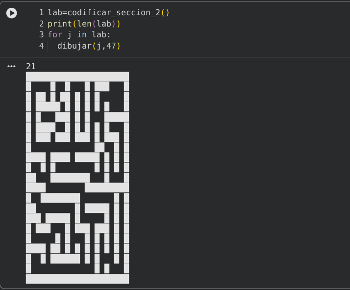

# L1 · Primer contacto — Sesión 2
## Momento 2 · Ejecutar — Construcción del mensaje de los Glitx Synkai

> [!info] Alcance de esta nota
> Registro de mi trabajo realizado **hasta la generación y descarga de `mensaje.txt`**, incluyendo las preguntas de representación, las funciones del canal y la comparación experimental de protecciones. Diseñé el mensaje e implementé las funciones; utilicé la IA como acompañamiento para discutir conceptos, identificar errores en mis intentos y organizar esta nota. Dejé la versión alternativa con bits de control **para un ejercicio personal de refuerzo**, sin alterar la implementación del laboratorio.

**Especie que diseñé:** Glitx Synkai  
**Sistema de numeración que elegí:** base 8  
**Fuente del diseño original:** `tarea_puente/parte_c.md`

---

## 1. Antecedentes: Momento 1 — Predecir
  

>**P4.** ¿Qué fracción de su mensaje creen que la otra especie va a entender? Un número entre 0 y 1, y qué sección creen que se va a perder primero.  

>**P5.** Si el canal daña 1 de cada 100 bits, ¿cuántos bits dañados esperan en su mensaje? ¿Y si lo mandan tres veces


> [!note] P4 — Predicción de comprensión
> Estimé que la especie receptora comprenderá aproximadamente **0,5 (50 %)** de nuestro mensaje. La interpretación del laberinto, especialmente la distinción entre paredes (`1`) y espacios transitables (`0`), es la parte que considero más vulnerable a una lectura incorrecta.

Durante mi análisis formulé estas estimaciones de comprensión por elemento:

| Elemento | Estimación inicial |
|:--|--:|
| Deducir la disposición rectangular | 0,9 |
| Identificar la base 8 | 0,8 |
| Reconocer las paredes | 0,4 |
| Reconocer los espacios transitables | 0,4 |
| Comprender el recorrido de una región de 2 × 2 hacia otra de 3 × 3 | 0,6 |
| Reconocer el personaje | 0,8 |
| Identificar el orden de lectura | 0,8 |

Estas cifras representan **predicciones subjetivas** sobre la comprensión de componentes, no proporciones medidas de bits descifrados.

> [!note] P5 — Predicción de errores
> Cuando respondí esta pregunta en papel, el mensaje disponible era el **boceto original de 1679 bits**. Con una probabilidad de error por bit de `p = 0.01`, calculé una esperanza de `1679 × 0.01 = 16.79` bits alterados por transmisión y `3 × 16.79 = 50.37` bits alterados en el conjunto de tres transmisiones.

La cantidad dañada es un **valor esperado**, no necesariamente el número exacto de errores. También analicé que tres copias pueden permitir una **votación por mayoría**, aunque no garantizan la recuperación de todos los bits.

> [!warning] Cambio posterior del tamaño del mensaje
> Tras el ensamblado, el mensaje cambió a **2491 bits**. Si actualizo el cálculo de P5 para la versión **final no protegida**, la esperanza pasa a `2491 × 0.01 = 24.91` bits alterados en una transmisión, o `3 × 24.91 = 74.73` alteraciones esperadas entre tres copias. Conservo ambas cifras y explicar su contexto en lugar de modificar retrospectivamente la predicción realizada en papel.

---

## 2. Verificación de las herramientas anteriores

Reutilicé las funciones que elaboré en la sesión 1 y en la tarea puente:

- `es_primo`, `rectangulos`;
- `filas_de`, `dibujar`, `leer_numero`, `columna`;
- `a_base_ciclo`, `de_base` (y la versión recursiva desarrollada en la tarea puente).

## 3. Bits necesarios por dígito

Para una base `b`, necesito el menor entero `k` que satisfaga:

$$
2^k\ge b.
$$

Como `MI_BASE = 8`:

$$
2^3 = 8 \quad \Longrightarrow \quad ANCHO = 3.
$$

### Funciones propias

```python
def bits_por_digito(b):
    """CONTRATO. Recibe una base b >= 2. Devuelve el menor k con 2**k >= b."""
    k = 1
    while 2**k < b:
        k += 1
    return k


def digito_a_bits(d, ancho):
    """CONTRATO. Devuelve la representación binaria del dígito
    usando exactamente 'ancho' caracteres, con ceros a la izquierda."""
    lista_bits = a_base_ciclo(d, 2)
    bits = ""
    for i in lista_bits:
        bits += str(i)
    return "0" * (ancho - len(bits)) + bits
```

Las pruebas oficiales pasaron y Colab mostró:

```text
✔ Su especie escribe cada dígito con 3 bits.
```

> [!important] Dos tipos de relleno
> `digito_a_bits` agrega ceros **a la izquierda** para completar un dígito. En cambio, `renglon(contenido)` agrega ceros **a la derecha** para alcanzar el número fijo de columnas establecido en el cuaderno.

---

## 4. Sección 1 — Conteo octal

`codificar_conteo(hasta)` debe devolver un renglón por cada número **del 1 al `hasta`**, convirtiendo primero el número a la base de la especie, representando cada dígito con `ANCHO` bits y completando el renglón con `renglon()`.

### Implementación que desarrollé

```python
def codificar_conteo(hasta):
    """CONTRATO. Devuelve una lista de renglones: el renglón i tiene
    el número i (de 1 a 'hasta') escrito en MI_BASE, cada dígito
    con ANCHO bits."""
    renglones = []
    for i in range(1, hasta + 1):
        base = a_base_ciclo(i, MI_BASE)
        bits = ""
        for j in base:
            bits += digito_a_bits(j, ANCHO)
        rengl = renglon(bits)
        renglones.append(rengl)
    return renglones
```

La prueba del cuaderno:

```python
conteo = codificar_conteo(MI_BASE + 2)
```

produce **10 renglones**. El cambio decisivo es:

$$
(7)_8 = (111)_2,\qquad (10)_8 = (001\ 000)_2.
$$

---

## 5. Sección 2 — Laberinto

Decidí **conservar el laberinto original de 21 × 21 celdas**, ubicándolo al extremo izquierdo de cada renglón de la nueva representación.

En el mensaje original, formado por **23 filas y 73 columnas**, el laberinto comienza en la fila `1` y columna `6`, numeradas desde cero. Su índice inicial en la cadena de bits es:

$$
i=73f+c=73(1)+6=79.
$$

Recuperé 21 fragmentos de 21 bits. El comienzo de cada fila se obtiene avanzando **73 posiciones**, ya que ese es el ancho de la **matriz de origen**:

| Fila | Corte aplicado a la cadena original |
|:--|:--|
| Primera | `bits[79:100]` |
| Segunda | `bits[152:173]` |
| Siguientes | Inicio anterior + 73 |

Cada fragmento pasa por `renglon()` para alcanzar el ancho elegido en la versión ensamblada. **No se debe cambiar el avance de 73**, aunque `COLUMNAS` cambie, porque ese avance corresponde a la matriz original.

Mi función `codificar_seccion_2()` devuelve **21 renglones**. Comprobé que la visualización reproduce el laberinto diseñado; la apariencia cambia en Colab porque `dibujar()` representa los unos con el carácter `█`, mientras que en el boceto original eran celdas negras.



---

## 6. Sección 3 — Secuencia del personaje

Mantuve los dibujos del personaje tipo Pac-Man, la región inicial pequeña, la región final mayor y las flechas que indican la secuencia visual.

En la matriz original, identifiqué como región de extracción:

| Propiedad | Valor |
|:--|--:|
| Fila inicial | 1 |
| Columna inicial | 29 |
| Índice inicial | 102 |
| Filas extraídas | 20 |
| Bits extraídos por fila | 42 |
| Avance entre filas originales | 73 |

El índice inicial se calculó mediante:

$$
i=73(1)+29=102.
$$

Los primeros cortes son `bits[102:144]` y `bits[175:217]`. Completé los fragmentos usando `renglon()` y se devuelven como **20 renglones**.

Al ejecutar `codificar_seccion_3()` pude visualizar los personajes y las flechas; comprobé que el resultado respetaba el contenido de mi boceto.


---

## 7. Ensamblado del mensaje

Implementé la función `ensamblar(secciones)` con dos ciclos anidados: el primero recorre las secciones y el segundo recorre los renglones de cada una, concatenándolos en una sola cadena.

### Implementación propia

```python
def ensamblar(secciones):
    """CONTRATO. Recibe una lista de secciones (cada una, una lista
    de renglones). Devuelve una sola cadena de bits: todos los
    renglones, uno detrás de otro."""
    cadena = ""
    for i in secciones:
        for j in i:
            cadena += j
    return cadena
```

La función **conserva el contrato oficial** de concatenación vertical. Paso las filas vacías de separación como elementos adicionales a `ensamblar()`; mi función no las incorpora automáticamente.

## 8. La forma — Decisión final

Inicialmente, con `COLUMNAS = 73`, obtuve un mensaje de **51 filas** y **3723 bits**:

$$
51\times73=3723=3\times17\times73.
$$

Como 51 no es primo, aparecían numerosas disposiciones rectangulares posibles. Propuse reducir el ancho a **47 columnas**, porque el dibujo más ancho (la secuencia visual) ocupa **42** y el laberinto **21**. El conteo también cabe en 47 bits.

A continuación, decidí separar las tres secciones con **una fila completa de ceros entre cada par de secciones**. Así se añaden exactamente dos filas a las 51 existentes:

| Parte | Filas | Rango de filas en el mensaje nuevo |
|:--|--:|:--|
| Conteo octal | 10 | 0–9 |
| Separación de ceros | 1 | 10 |
| Laberinto | 21 | 11–31 |
| Separación de ceros | 1 | 32 |
| Movimiento del personaje | 20 | 33–52 |
| **Total** | **53** | **0–52** |

Por tanto, el mensaje ensamblado tiene:

$$
\boxed{N=53\times47=2491\text{ bits}}.
$$

Como **47 y 53 son números primos**, las únicas parejas de divisores ordenadas son:

```text
(1, 2491), (47, 53), (53, 47), (2491, 1)
```

### Ensamblado con separadores, sin cambiar los contratos

A partir de mi implementación ya terminada, agregué los separadores como listas que contienen un único renglón de ceros:

```python
mensaje = ensamblar([
    codificar_conteo(MI_BASE + 2),
    [COLUMNAS * "0"],
    codificar_seccion_2(),
    [COLUMNAS * "0"],
    codificar_seccion_3()
])
```

El valor final de `COLUMNAS` es **47**. No se modifican las coordenadas de lectura del **boceto original** ni el avance `fila += 73` usado para extraer sus regiones.

### Resultado observado en Google Colab

```text
Longitud del mensaje: 2491 bits
Formas de dibujarlo:
[(1, 2491), (47, 53), (53, 47), (2491, 1)]
```


Comprobé visualmente la concatenación **conteo → separación → laberinto → separación → personaje**, respetando las tres ideas originales del proyecto.

> [!success] Estado alcanzado
> Completé la construcción y el ensamblado del mensaje propio siguiendo los contratos del profesor. El mensaje final **sin protección y sin ruido** contiene **2491 bits**, organizados en **53 filas y 47 columnas**.

---

---

## 9. Las preguntas incómodas de la representación

La guía me pidió responder **al menos dos** preguntas relacionadas con las limitaciones de mi sistema de representación. Elegí **ancho fijo** y **decimales**, porque se relacionan con la base 8 que utilicé y con las convenciones que debería interpretar otra civilización.

### 9.1. Pregunta 1 — Ancho fijo y desbordamiento


> Si cada número va en un renglón de `COLUMNAS` bits, ¿cuál es el número más grande que cabe en su base? ¿Qué pasa si quieren decir cuántos habitantes tiene Manizales? A esto se le llama **desbordamiento**.

#### 9.1.1. Cantidad de dígitos completos

En mi sistema tengo:

```python
MI_BASE = 8
ANCHO = 3
COLUMNAS = 47
```

Cada dígito octal ocupa exactamente tres bits. Para determinar cuántos dígitos caben en un renglón calculé:

$$
\frac{47}{3}=15{,}666\ldots
$$

Concluí que caben **15 dígitos octales completos**; ocupan $15\cdot3=45$ bits y quedan **dos bits de relleno**. No puedo usarlos para un decimosexto dígito octal.

#### 9.1.2. Mayor número representable

Como los dígitos octales van de 0 a 7, el mayor número posible con 15 dígitos es:

$$
(777777777777777)_8.
$$

Deduje la fórmula general considerando que en una base $b$ el mayor dígito es $b-1$:

$$
\begin{aligned}
N_{\max}&=(b-1)b^{k-1}+\cdots+(b-1)b+(b-1)\\
&=(b-1)(b^{k-1}+\cdots+b+1)\\
&=(b-1)\frac{b^k-1}{b-1}\\
&=\boxed{b^k-1}.
\end{aligned}
$$

Por tanto, en mi sistema:

$$
\boxed{N_{\max}=8^{15}-1}.
$$

Para comprobar el razonamiento con un ejemplo pequeño, utilicé tres dígitos octales:

$$
\begin{aligned}
(777)_8&=7\cdot8^2+7\cdot8+7\\
&=448+56+7=511=8^3-1.
\end{aligned}
$$

#### 9.1.3. Desbordamiento

Observé que, al sumar una unidad al máximo, necesito una posición adicional. Por ejemplo:

$$
(77)_8+1=(100)_8.
$$

De igual manera, $8^{15}$ requiere **16 dígitos octales**. Al usar tres bits por dígito, necesitaría:

$$
16\cdot3=48\text{ bits}>47\text{ bits}.
$$

Por tanto, **no cabe en mi renglón**. Además, `renglon()` comprueba mediante `assert` que el contenido no supere el ancho disponible; si recibiera 48 bits, produciría un `AssertionError`.

> [!important] Mi conclusión
> Puedo representar una cantidad de habitantes, como la de Manizales, **si su valor se encuentra entre 0 y $8^{15}-1$**. Si supera ese límite, mi representación de un número por renglón deja de ser suficiente. El `assert` detecta ese caso, pero no resuelve por sí mismo cómo transmitir un número mayor.

### 9.2. Pregunta 2 — Decimales y unidades de medida

> ¿Cómo dicen la altura de Manizales en metros si el otro no sabe qué es un metro, ni dónde va la coma? La guía menciona como pista las placas Pioneer de 1972 y una propiedad física del átomo de hidrógeno.

Identifiqué **dos dificultades distintas**: mi codificación actual solo maneja números enteros y, aunque otra especie comprendiera la cifra, podría desconocer la unidad de medida.

#### 9.2.1. Expresar fracciones mediante enteros

Propuse utilizar **una unidad más pequeña** para eliminar, en ciertos casos, la necesidad de escribir una coma decimal. Como ejemplo tomé:

$$
12{,}5\text{ m}=1250\text{ cm}.
$$

La longitud física no cambia; solo cambia la unidad y el valor numérico utilizado para expresarla. Sin embargo, este cambio no ayuda si el receptor tampoco conoce qué es un centímetro.

#### 9.2.2. Elegir una referencia física

Consideré conveniente usar una **propiedad física reproducible bajo condiciones definidas**, en lugar de depender únicamente de una convención humana. La pista del hidrógeno de la guía ejemplifica esa posibilidad.

Para examinar mi propuesta supuse una longitud de referencia $L$ y una unidad menor $u$ tal que:

$$
u=\frac{L}{2},\qquad L=2u.
$$

Entonces una longitud fraccionaria se puede representar mediante un número entero de unidades más pequeñas:

$$
2{,}5L=2{,}5(2u)=\boxed{5u}.
$$

Puedo codificar el entero 5 en mi sistema:

$$
(5)_8=(101)_2.
$$

Pero reconocí que el receptor necesita conocer **qué referencia representa $L$**, **cómo definir $u$** y **cuál es la relación $L=2u$**. El número 5, por sí solo, no comunica esa información.

> [!important] Mi conclusión
> Podría comunicar determinadas cantidades fraccionarias mediante enteros si establezco y comunico una unidad suficientemente pequeña. También necesitaría una referencia física reconocible para la otra especie y una forma de expresar la relación entre unidades. Esta es una **propuesta conceptual**: no la incorporé a los bits de mi mensaje actual.

### 9.3. Límites de interpretación que identifiqué

Al finalizar, distinguí entre lo que **codifiqué realmente** y lo que **solo propuse**. Mi mensaje original de 2491 bits contiene el conteo en base 8, un laberinto y una secuencia visual relacionada con un videojuego. No incluye una convención para fracciones ni una referencia de unidades físicas.

Además, aunque la secuencia numérica sea correcta, el receptor podría interpretar los grupos de tres bits como un número binario y no inferir la base 8.

> [!warning] Ambigüedades
> Identifiqué que comunicar símbolos no garantiza que otra especie reconstruya mis convenciones. Puede reconocer partes del dibujo, interpretar otro significado para los ceros y unos o no deducir cómo agrupé los números. Por eso decidí **no añadir filas ni columnas** en esta versión; conservaré estas propuestas para un ejercicio personal posterior.

---

## 10. El canal — Simulación y protección del mensaje

En esta actividad simulé un canal que puede **invertir cada bit con probabilidad $p$**. Comparé dos estrategias: la **paridad par**, que permite detectar ciertas alteraciones, y la **repetición triple**, que puede corregir algunas de ellas.

### 10.1. Interpretación de la probabilidad de ruido

Para $p=0.01$, concluí que **cada bit tiene un 1 % de probabilidad de invertirse**, y no que necesariamente cambie exactamente uno de cada cien bits.

Para mi mensaje original de 2491 bits, el número esperado de inversiones sería:

$$
E[X]=2491\cdot0.01=24{,}91.
$$

Es un valor esperado; las inversiones reales varían en cada ejecución.

### 10.2. Función `ruido(bits, p)`

Construí una cadena auxiliar porque las cadenas de Python son inmutables. Para cada bit generé un número con `random.random()`: si era menor que $p$, invertía el bit; de lo contrario, lo conservaba.

**Mi implementación:**

```python
import random

def ruido(bits, p):
    """CONTRATO. Devuelve una copia de bits donde cada bit se volteó con probabilidad p."""
    cadena_ruido = ""
    for i in bits:
        prob = random.random()
        if prob < p and i == "1":
            cadena_ruido += "0"
        elif prob < p and i == "0":
            cadena_ruido += "1"
        else:
            cadena_ruido += i
    return cadena_ruido
```

En mis primeros intentos descubrí que modificar la variable del ciclo no modificaba `bits`, y luego corregí un `=` que sobrescribía la cadena auxiliar en lugar de utilizar `+=`.

### 10.3. Protección por paridad — `con_paridad(bits, ancho)`

Dividí el mensaje en renglones mediante mi función previa `filas_de(bits, ancho)`. A cada renglón le agregué un bit para garantizar una cantidad **par** de unos:

- Si la cantidad de unos ya es par, agrego `0`.
- Si es impar, agrego `1`.

**Mi implementación:**

```python
def con_paridad(bits, ancho):
    """CONTRATO. Parte bits en renglones de 'ancho' y a cada uno le agrega
    un bit de paridad al final, para obtener un número par de unos."""
    renglo = filas_de(bits, ancho)
    cadena_paridad = ""
    for i in renglo:
        num_unos = i.count("1")
        aux = ""
        aux += i
        if num_unos % 2 == 0:
            aux += "0"
        elif num_unos % 2 != 0:
            aux += "1"
        cadena_paridad += aux
    return cadena_paridad
```


Mi mensaje contiene **53 renglones de 47 bits**, así que tras añadir la paridad tiene:

$$
53(47+1)=\boxed{2544\text{ bits}}.
$$

### 10.4. Detección — `filas_danadas(bits, ancho)`

Para revisar la paridad del mensaje recibido, debo dividirlo en renglones de **`ancho + 1`**, pues el bit extra ya forma parte de cada uno. Guardé los índices, comenzando en cero, de los renglones con una cantidad impar de unos.

**Mi implementación:**

```python
def filas_danadas(bits, ancho):
    """CONTRATO. Recibe bits con paridad en renglones de ancho + 1.
    Devuelve los índices de los renglones con un número impar de unos."""
    renglo = filas_de(bits, ancho + 1)
    indice = 0
    bits_danados = []
    for i in renglo:
        num_unos = i.count("1")
        if num_unos % 2 != 0:
            bits_danados.append(indice)
        indice += 1
    return bits_danados
```

Mi función `filas_de()` devuelve una lista cuando la longitud es divisible por el ancho, pero devuelve `None` en su otra rama. Identifiqué que eso explicaba la advertencia del editor; para **nuestro mensaje**, las longitudes utilizadas sí son divisibles entre los anchos correspondientes.

> [!warning] Límite de la paridad
> La paridad puede detectar una cantidad **impar** de inversiones en un mismo renglón. Si se invierte una cantidad **par** de bits en ese renglón, la paridad permanece par y la alteración puede pasar inadvertida. Además, detectar un renglón dañado no permite reconstruir automáticamente qué bits se invirtieron.

### 10.5. Protección por repetición — `repetir3(bits)`

Mi segunda estrategia consistió en repetir tres veces cada carácter de la cadena original.

**Mi implementación:**

```python
def repetir3(bits):
    """CONTRATO. Devuelve bits con cada carácter repetido tres veces seguidas."""
    cadena_rep = ""
    for i in bits:
        cadena_rep += i * 3
    return cadena_rep
```

La longitud aumenta a:

$$
3(2491)=\boxed{7473\text{ bits}}.
$$

### 10.6. Recuperación mediante votación — `votar(bits)`

Primero dividí los bits recibidos en grupos de tres con `filas_de(bits, 3)` y después elegí el bit mayoritario. Como cada grupo tiene tres posiciones, no puede producirse un empate entre ceros y unos.

**Mi implementación:**

```python
def votar(bits):
    """CONTRATO. Por cada grupo de tres bits devuelve el que aparece al menos dos veces."""
    grupo = filas_de(bits, 3)
    cadena_orig = ""
    for j in grupo:
        if j.count("1") < j.count("0"):
            cadena_orig += "0"
        else:
            cadena_orig += "1"
    return cadena_orig
```

La votación recupera el bit original si **como máximo una de sus tres copias** fue alterada. Si cambian dos o tres copias, la mayoría puede resultar equivocada.

### 10.7. Pruebas 

Ejecuté las pruebas `assert` incluidas en el cuaderno para las cinco funciones:

```python
random.seed(0)
assert ruido("0101", 0) == "0101" and ruido("0101", 1) == "1010"
assert con_paridad("110100", 3) == "11001001"
assert filas_danadas("11001001", 3) == [] and filas_danadas("11011001", 3) == [0]
assert repetir3("10") == "111000" and votar("110001") == "10" and votar(repetir3("1011")) == "1011"
print("✔ El canal y las dos protecciones pasan las pruebas.")
```

**Resultado que obtuve en Colab:**

```text
✔ El canal y las dos protecciones pasan las pruebas.
```

Estas pruebas confirman los casos concretos evaluados por el cuaderno; no constituyen una demostración de que la transmisión siempre pueda recuperarse.

### 10.8. Experimento — «Medir, no suponer»

Realicé **1000 transmisiones simuladas** con probabilidad de inversión de $p=0.01$ y comparé ambos mecanismos.

**Mi implementación de los contadores:**

```python
N = 1000
p = 0.01

con_error = detectadas = no_detectadas = 0
recuperadas_rep = 0

for _ in range(N):
    # Paridad
    protegido = con_paridad(mensaje, COLUMNAS)
    recibido = ruido(protegido, p)
    if protegido != recibido:
        con_error += 1
        if filas_danadas(recibido, COLUMNAS):
            detectadas += 1
        else:
            no_detectadas += 1

    # Repetición
    rep_bits = repetir3(mensaje)
    rui_prot = ruido(rep_bits, p)
    men_rec = votar(rui_prot)
    if mensaje == men_rec:
        recuperadas_rep += 1

print("Paridad   : con error", con_error, "| detectadas", detectadas, "| sin detectar", no_detectadas)
print("Repetición: recuperadas exactas", recuperadas_rep, "de", N)
print("Costo en bits: original", len(mensaje), "| paridad", len(con_paridad(mensaje, COLUMNAS)),
      "| repetición", len(repetir3(mensaje)))
```

**Salida observada:**

```text
Paridad   : con error 1000 | detectadas 1000 | sin detectar 0
Repetición: recuperadas exactas 459 de 1000
Costo en bits: original 2491 | paridad 2544 | repetición 7473
```

| Indicador | Resultado de esta ejecución |
|:--|--:|
| Transmisiones de paridad con al menos un error | 1000 |
| Transmisiones con errores detectados por paridad | 1000 |
| Transmisiones con errores totalmente inadvertidos | 0 |
| Mensajes recuperados exactamente por repetición triple | 459 de 1000 (45,9 %) |
| Mensajes no recuperados exactamente por repetición | 541 de 1000 (54,1 %) |

Comprobé que se cumple:

$$
\text{con\_error}=\text{detectadas}+\text{no\_detectadas}=1000.
$$

> [!important] Interpretación correcta de la paridad
> Que `no_detectadas = 0` **no significa que todos los bits o renglones dañados hayan sido identificados**. Significa que, en esta ejecución, cada una de las 1000 transmisiones con error tuvo **al menos un renglón** donde la paridad señaló una anomalía. Algunas alteraciones dentro de otros renglones pudieron pasar inadvertidas.

> [!note] Interpretación correcta de la repetición
> La cifra de **459** significa que en 459 transmisiones reconstruí exactamente los **2491 bits** originales. En las otras 541 quedó **al menos un bit incorrecto**; no implica que todas sus secciones estén destruidas. Como el canal es aleatorio, estos valores pueden cambiar si repito el experimento.


### 10.10. Elección de la protección

Inicialmente consideré que la **paridad** era mejor porque había detectado las 1000 transmisiones dañadas. Después reconsideré mi elección: si el mensaje tarda **25 000 años** en llegar, reconocer que está alterado no basta para reconstruir su contenido, y solicitar otro envío no sería una solución práctica.

Finalmente elegí la **repetición triple**, porque puede **corregir algunas inversiones** sin conocer el mensaje original. En mi ejecución, reconstruyó exactamente 459 de 1000 mensajes. Incluso cuando no reconstruye el mensaje entero, algunas secciones podrían permanecer interpretables: el conteo, parte del laberinto o elementos del dibujo. Esto último es una **posibilidad**, no una garantía experimental sobre el significado recuperado.

> [!success] Mi decisión
> Elegí **repetición triple**. Prefiero dedicar más bits a intentar recuperar información que limitarme a detectar errores en un mensaje cuya retransmisión sería extremadamente costosa.

---

## 11. Mandar el mensaje — Transmisión final

La guía indicó elegir una protección, pasar el mensaje **una sola vez** por el canal con $p=0.01$ y guardar el resultado en `mensaje.txt`, sin agregar metadatos sobre ancho ni protección.

### 11.1. Protección elegida y ejecución

Elegí la opción:

```python
PROTECCION = "repeticion"
```

A continuación ejecuté la celda proporcionada por el profesor:

```python
PROTECCION = "repeticion"

if PROTECCION == "paridad":
    enviado = ruido(con_paridad(mensaje, COLUMNAS), 0.01)
else:
    enviado = ruido(repetir3(mensaje), 0.01)

with open("mensaje.txt", "w") as f:
    f.write(enviado)
print("mensaje.txt listo:", len(enviado), "bits. Entréguenlo al monitor.")
```

El modo `"w"` **crea** el archivo si todavía no existe y **sobrescribe** su contenido si ya existe. Reconocí por ello que no debo volver a ejecutar la celda, pues el ruido aleatorio podría generar otra transmisión y reemplazar la primera.

**Resultado obtenido en Colab:**

```text
mensaje.txt listo: 7473 bits. Entréguenlo al monitor.
```


---

**Fuente de referencia:** cuaderno oficial *L1 — Primer contacto, sesión 2* (`L1_sesion2.ipynb`).
