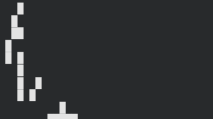
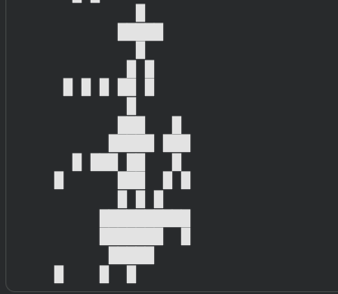

# L1 — Primer contacto | Sesión 2

## 6. El día del contacto — Recibiendo un mensaje

**Curso:** Introducción a las Ciencias de la Computación  
**Actividad:** L1 — Primer contacto, sesión 2  
**Archivo recibido:** `recibido.txt`  
**Especie emisora:** Cafeteros de la Montaña  

---

### 6.1. Objetivo y condiciones de la actividad

En esta actividad recibí una cadena binaria elaborada por otra especie del laboratorio. Mi objetivo es intentar identificar su organización, la posible protección frente a errores, el sistema de numeración y el contenido de las representaciones visuales.

A diferencia de mi propio mensaje, inicialmente desconozco qué convenciones siguió el emisor. Por ello decidí **formular hipótesis y someterlas a pruebas**, sin asumir de antemano que utilizó las mismas reglas que yo.

### 6.2. Lectura del mensaje y análisis de su longitud

Primero cargué el archivo `recibido.txt` en Google Colab y utilicé las herramientas de la sesión 1 para examinar la cadena.

```python
with open("recibido.txt") as f:
    ajeno = f.read().strip()

print("Longitud:", len(ajeno))
print("Formas posibles:", rectangulos(len(ajeno)))
```

**Resultados obtenidos:**

```text
Longitud: 1311
Formas posibles:
[(1, 1311), (3, 437), (19, 69), (23, 57),
 (57, 23), (69, 19), (437, 3), (1311, 1)]
```

Identifiqué que la cadena contiene **1311 bits** y que su longitud admite varias disposiciones rectangulares. La factorización es:

$$
1311=3\cdot19\cdot23.
$$

Por sí sola, esta longitud no revela cuál es la forma elegida por el emisor.

### 6.3. Primera hipótesis: protección mediante repetición triple

Observé que la longitud del mensaje era divisible entre 3. Como en la actividad anterior implementé una protección que repite cada bit tres veces, consideré que el otro equipo **podría haber utilizado repetición triple**.

Si esa hipótesis fuera correcta, la cadena recuperada tendría:

$$
\frac{1311}{3}=437\text{ bits}.
$$

Decidí aplicar mi función `votar()` para examinar esa posibilidad:

```python
recuperado = votar(ajeno)

print("Longitud recuperada:", len(recuperado))
print("Formas posibles:", rectangulos(len(recuperado)))
```

**Resultados obtenidos:**

```text
Longitud recuperada: 437
Formas posibles:
[(1, 437), (19, 23), (23, 19), (437, 1)]
```

Comprobé que:

$$
437=19\cdot23.
$$

Como **19 y 23 son primos**, las únicas disposiciones no triviales de esa cadena son las de **19 y 23 columnas**. Consideré que este resultado respaldaba mi hipótesis, aunque **la divisibilidad entre 3 no demuestra por sí misma el uso de repetición triple**.

### 6.4. Comparación de las disposiciones rectangulares

Visualicé las dos disposiciones no triviales de la cadena obtenida mediante votación:

```python
dibujar(recuperado, 19)
dibujar(recuperado, 23)
```

| Columnas indicadas en `dibujar()` | Dimensiones de la matriz | Observación inicial |
|:--|:--|:--|
| `19` | 23 filas × 19 columnas | Me pareció que los patrones estaban más organizados. |
| `23` | 19 filas × 23 columnas | Encontré más difícil reconocer una estructura. |

Después de comparar ambas visualizaciones, **elegí provisionalmente 19 columnas**. Mi elección se basó en la apariencia de las figuras, no en una confirmación del emisor.

> [!note] Hipótesis de disposición
> Consideré más prometedora una matriz de **23 filas por 19 columnas**. Mantengo la disposición de 23 columnas como una posibilidad que no he descartado de manera definitiva.

### 6.5. Comprobación adicional de la repetición triple

Reconocí que obtener una longitud divisible entre 3 no era suficiente para verificar la protección. Por eso propuse analizar los grupos de tres bits de la **cadena recibida original**, antes de aplicar `votar()`.

Mi razonamiento fue que, si cada bit se hubiera repetido tres veces y el canal introdujera pocos errores, deberían aparecer principalmente los grupos `000` y `111`.

Dividí la cadena en grupos de tres utilizando `filas_de(ajeno, 3)`. Inicialmente cometí un error en una condición: había escrito `i.count("0") == 0`, que vuelve a identificar `111`, en lugar de reconocer `000`. Después corregí la condición y ejecuté mi implementación:

```python
cadena_recb = filas_de(ajeno, 3)
grupo_unif = 0
grupo_no_unif = 0

for i in cadena_recb:
    if i.count("1") == 3 or i.count("0") == 3:
        grupo_unif += 1
    else:
        grupo_no_unif += 1

print(f"Grupos uniformes: {grupo_unif}")
print(f"Grupos no uniformes: {grupo_no_unif}")
```

**Resultados observados:**

```text
Grupos uniformes: 422
Grupos no uniformes: 15
```

Comprobé que clasifiqué los 437 grupos:

$$
422+15=437.
$$

La proporción de grupos uniformes fue:

$$
\frac{422}{437}\times100\approx96{,}57\%.
$$

Los grupos no uniformes representaron aproximadamente el **3,43 %**.

> [!important] Evaluación de mi hipótesis de protección
> Que **422 de 437 grupos** sean `000` o `111` es una evidencia fuerte a favor de la repetición triple, especialmente porque la guía contempla un canal con errores de baja probabilidad. Sin embargo, no lo considero una prueba definitiva: una cadena con otra estructura también podría presentar grupos uniformes.

### 6.6. Hipótesis sobre el sistema de conteo



Al observar la parte superior de la matriz de **19 columnas**, identifiqué una disposición parecida al conteo que construí para mi propio mensaje. Por esa razón planteé la hipótesis de que **cada uno de los primeros renglones representaba un número consecutivo**, sin una fila separadora entre ellos.

Reconocí inicialmente los siguientes patrones al comienzo de los renglones:

| Índice del renglón | Primeros bits que identifiqué | Interpretación provisional |
|---:|:--|:--|
| 0 | `001` | 1 |
| 1 | `010` | 2 |
| 2 | `011` | 3 |
| 3 | `100` | 4 |
| 4 | `101` | 5 |

En un primer momento observé que el patrón parecía desplazarse hacia la derecha en el renglón **6**, y consideré que esa transición podría indicar un cambio de posición numérica.

Inicialmente pensé en la **base 6**, pero surgió la duda de si el conteo empezaba desde 0 o desde 1. Los primeros renglones `001`, `010` y `011` reforzaron mi interpretación de que el conteo comenzaba desde **1**.

#### 6.6.1. Una dificultad: el segundo dígito puede ser invisible

Noté que el renglón de índice 5 parecía comenzar otra vez por `001`. Esto me hizo pensar inicialmente en un error. Después consideré que podría tratarse de un número de **dos dígitos**, cuyo segundo dígito fuera `000` y no generara bloques visibles en el dibujo.

Esta posibilidad es coherente con un conteo en base 6:

$$
(5)_6+1=(10)_6.
$$

Si cada dígito ocupa tres bits, las siguientes representaciones serían:

| Índice del renglón | Número decimal | Número en base 6 | Grupos de tres bits |
|---:|---:|:--|:--|
| 4 | 5 | $(5)_6$ | `101` |
| 5 | 6 | $(10)_6$ | `001 000` |
| 6 | 7 | $(11)_6$ | `001 001` |
| 7 | 8 | $(12)_6$ | `001 010` |

La aparición de un bit a la derecha en el renglón 6 se explicaría porque el segundo dígito pasa de `000` a `001`.

#### 6.6.2. Comprobación con los bits recibidos

Decidí comprobar directamente los primeros seis bits de los renglones implicados:

```python
renglones = filas_de(recuperado, 19)

print(renglones[5][:6])
print(renglones[6][:6])
print(renglones[7][:6])
```

**Resultados que obtuve:**

```text
001000
001001
001010
```

Estos tres resultados coinciden exactamente con lo que predice el conteo consecutivo en base 6:

$$
(10)_6,\quad(11)_6,\quad(12)_6.
$$

> [!success] Hipótesis numérica respaldada
> Considero que la otra especie **probablemente utiliza base 6**, representa cada dígito mediante **3 bits** y comienza su conteo en el número **1**. Esta conclusión está respaldada por varios renglones consecutivos, no solamente por la apariencia general del dibujo.

### 6.7. Delimitación de la sección de conteo

A partir de la visualización observé que el patrón numérico parecía continuar **hasta el renglón de índice 7**, incluido. En el **renglón 8** vi una disposición diferente que ya no parecía corresponder a la secuencia numérica.

Por tanto, planteé la siguiente división provisional:

| Renglones, numerados desde 0 | Contenido hipotético |
|:--|:--|
| 0–7 | Conteo del 1 al 8, en base 6 |
| 8–22 | Contenido visual o nuevas secciones aún no delimitadas |

Esta separación es una **inferencia basada en la visualización**, no una convención confirmada por la especie emisora. Tampoco he demostrado que el resto del mensaje contenga una única sección.

### 6.8. Primeras interpretaciones de las figuras



Al observar los patrones situados por debajo del conteo, intenté identificar figuras reconocibles.

Mis primeras impresiones fueron las siguientes:

- **Una figura semejante a una taza**, que logré reconocer a simple vista.
- **Una figura parecida a una cruz** en la parte superior de la zona visual.
- **Otros patrones intermedios** cuyo significado no he conseguido identificar.

También consideré inicialmente que podía aparecer una especie de **greca de café**, pero no encontré evidencia visual suficiente para sostener esa interpretación; por ahora la dejé sin confirmar.

Decidí interpretar la posible cruz y la posible taza como **dos figuras independientes**, puesto que no encontré una relación clara entre ellas.

| Elemento | Interpretación que propuse | Estado |
|:--|:--|:--|
| Figura semejante a una taza | Posible taza | Reconocimiento visual provisional |
| Figura con forma de cruz | Posible cruz | Reconocimiento visual provisional |
| Patrones intermedios | Sin interpretar | Desconocido |
| Relación entre las figuras | Por ahora, independientes | No confirmada |

> [!warning] Diferencia entre reconocer e interpretar
> Puedo asociar una forma binaria con un objeto conocido, pero eso **no significa que el emisor quisiera representar ese objeto** ni que comparta mis referencias culturales. Considero que contar con algo de contexto podría facilitar la interpretación; en este momento no tengo suficiente información para establecer el significado de las imágenes.


### 6.9. Respuesta preliminar a la sección 6 de la guía

> [!question] Lo que entendí del mensaje de la especie emisora
>
> - **Ancho que deduje:** 19 columnas, porque al aplicar tentativamente la votación mayoritaria obtuve 437 bits, y la disposición de 23 filas × 19 columnas presentó patrones que me parecieron más organizados.
> - **Base que deduje:** base 6, porque la secuencia del conteo coincide con los números 1, 2, 3, 4, 5, $(10)_6$, $(11)_6$ y $(12)_6$, codificando cada dígito en tres bits.
> - **Protección que creo que utilizaron:** repetición triple, porque el 96,57 % de los grupos de tres bits recibidos son uniformes y `votar()` deja una cadena con una disposición rectangular plausible.
> - **Lo que interpreto de las secciones:**
>   1. **Sección superior:** posible conteo consecutivo del 1 al 8.
>   2. **Zona visual:** figura que se parece a una cruz, sin significado identificado.
>   3. **Zona visual:** figura que se parece a una taza; desconozco si forma parte de otra sección o de un dibujo mayor.
>
> **Aclaración:** no tengo evidencia para asegurar que las figuras constituyan exactamente dos secciones distintas ni que mis nombres correspondan a lo que quiso transmitir el emisor.

### 6.11. Reflexión sobre la interpretación

Durante este proceso comprobé que mis herramientas de la sesión 1 sí sirven para investigar una cadena que no conocía: pude calcular sus divisores, probar disposiciones, observar patrones, contrastar una hipótesis de protección y estudiar el conteo.

Sin embargo, también reconocí un límite: **recuperar bits e identificar una base no equivale a comprender el significado completo del mensaje**. Las figuras pueden parecerme familiares y, aun así, representar algo diferente para la especie emisora.

Por ahora considero que mi interpretación numérica está mejor sustentada que mi interpretación visual. Me parece necesario conservar esa diferencia al presentar los resultados.


---

**Fuente de referencia:** cuaderno oficial *L1 — Primer contacto, sesión 2*, secciones 6 «El día del contacto» y 7 «La revelación»: `cmorregof/labs-calculo-2026-2/introduccion_cc/L1_sesion2.ipynb`.
