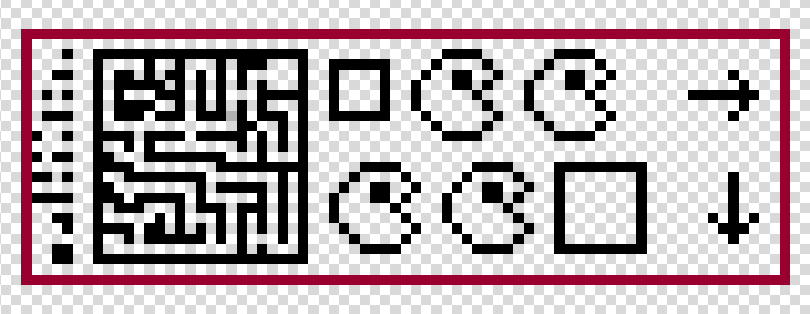
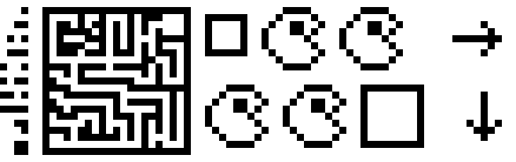

# Tarea puente — Parte C · Nuestra especie: Glitx Synkai

> [!info] Autoría y alcance
> El mensaje visual y sus convenciones fueron propuestos, revisados y dibujados por el equipo **Glitx Synkai**, cuya base asignada es **8**. La IA se utilizó como apoyo para discutir la coherencia de las ideas, transcribir el boceto a bits y verificar las propiedades de la cadena.

## 1. Propósito del mensaje

Nuestra especie quiere comunicar su interés por los **videojuegos y la programación**, mediante una representación sencilla de un recorrido. La idea consiste en que un personaje se desplace desde una región inicial pequeña hasta una región final más grande, dentro de un laberinto con obstáculos.

Para evitar una representación demasiado compleja, decidimos no incorporar enemigos, persecuciones ni recolección de monedas. Conservamos únicamente el mapa, los espacios transitables, los obstáculos y el desplazamiento entre dos zonas.

### Secciones propuestas

| Sección | Qué intenta comunicar |
|:--|:--|
| 1. Conteo | Nuestro sistema de numeración en **base 8**. |
| 2. Mapa | La disposición de los pasillos, las paredes y las dos regiones especiales. |
| 3. Secuencia visual | El desplazamiento de un personaje desde la región de **2 × 2** hasta la de **3 × 3**. |

## 2. Boceto original

> [!important] Contorno de referencia
> La línea roja es una **guía de edición**, no un elemento transmitido. **Ningún píxel del contorno rojo forma parte de la secuencia de bits.** Solo se consideran las 23 filas y 73 columnas interiores.

### Decisiones de representación

- **Forma del mensaje:** 23 filas por 73 columnas; en total, **1679 bits**.
- **Lectura del contenido:** de izquierda a derecha y de arriba hacia abajo.
- **Conteo:** los dígitos octales se codifican mediante grupos de tres bits, con un bit de control para distinguir columnas o posiciones válidas de separaciones. En el boceto final, el conteo se presenta verticalmente y sus bits se leen de izquierda a derecha.
- **Mapa:** un `0` representa un espacio transitable y un `1`, una pared u obstáculo. Las paredes delimitan el laberinto y los pasillos comunican las regiones.
- **Regiones especiales:** la zona de inicio corresponde a **2 × 2** celdas y la de llegada a **3 × 3** celdas.
- **Secuencia visual:** una figura sencilla de pixel art se repite en distintos estados; las flechas ayudan a sugerir el sentido de la secuencia, desde la región pequeña hacia la grande.

> [!note] Una misma secuencia puede admitir distintas interpretaciones
> En el mapa, `0` y `1` representan espacios y paredes. En el dibujo del personaje, representan píxeles de su silueta. El receptor deberá interpretar estas regiones según su contexto. Además, reconocer las formas no garantiza comprender que se trata de un videojuego.

## 3. Resultado de la transcripción del boceto

| Propiedad | Resultado |
|:--|--:|
| Filas | 23 |
| Columnas | 73 |
| Longitud de la secuencia | 1679 bits |
| Bits con valor `1` | 451 |
| Bits con valor `0` | 1228 |
| Orden de extracción | De izquierda a derecha y de arriba hacia abajo |

**SHA-256 de la cadena original en ASCII:** `1288f792449d4b30795de6954801ee00aac5419c2851864fb8fad5cfc61e2dab`.

**Archivo guardado en la carpeta `tarea_puente`:**

- `glitx_synkai_mensaje_bits.txt`: contiene los **1679 bits en una sola línea**, sin espacios ni saltos de línea. Este es el mensaje original, **sin protección ni ruido**.

## 4. Comprobación visual

La reconstrucción se realiza exclusivamente con los bits de las celdas interiores. Debemos cotejarla con el boceto para comprobar que no haya píxeles omitidos o agregados y que se haya respetado el orden de lectura.

## 5. Contrato de lectura — Predicción del equipo

1. **Reconstruir la forma del mensaje.** Identificar que la cadena de 1679 bits debe organizarse en una matriz de **23 filas y 73 columnas**.
2. **Reconocer el sentido de lectura.** Deducir que la información se interpreta de **izquierda a derecha y de arriba hacia abajo**.
3. **Identificar la base de numeración.** Reconocer, a partir de la sección de conteo y de sus bits de control, que los Glitx Synkai utilizan la **base 8**.
4. **Interpretar el laberinto.** Deducir que los `0` representan espacios transitables y los `1` representan paredes. La disposición del laberinto, encerrado por paredes, es la principal pista propuesta por el equipo.
5. **Comprender el propósito del personaje.** Interpretar, con ayuda de los dibujos sucesivos, que el personaje debe desplazarse desde la región de **2 × 2** hasta la región de **3 × 3**.

### Alcances y posibles ambigüedades

El contrato es una **hipótesis sobre lo que podría deducir el receptor**, no una garantía de comprensión. La otra especie podría identificar la matriz sin elegir la orientación esperada, reconocer el laberinto sin asociar correctamente los valores de sus celdas o interpretar las figuras como imágenes independientes en vez de una secuencia temporal.

### Verificaciones realizadas

- La longitud de la cadena es **1679** y se cumple `23 × 73 = 1679`.
- La cadena contiene únicamente los caracteres `0` y `1`.
- Se registran **451 unos** y **1228 ceros**; su suma es **1679**.
- El contorno rojo del editor **no se incluyó** entre los bits.
- La secuencia de `glitx_synkai_mensaje_bits.txt` **no sustituye** al `mensaje.txt` protegido y transmitido que se producirá durante la sesión 2.
